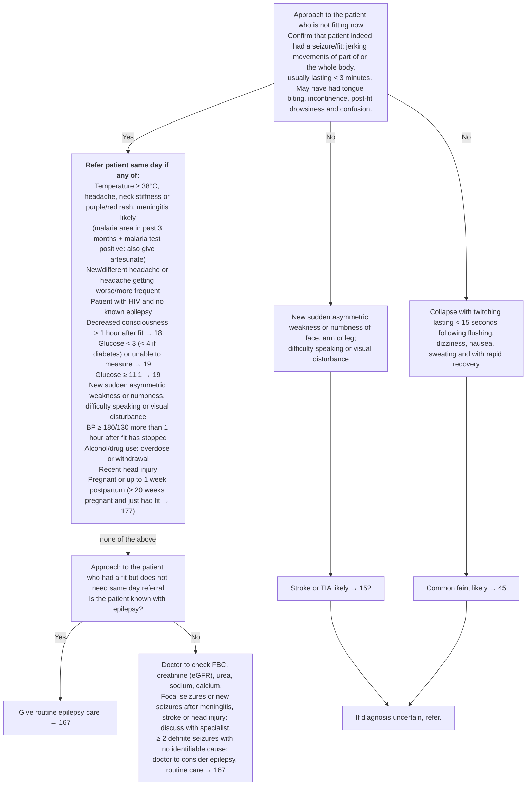

# Page 21 – Seizures/fits (cont. 2): flowchart

Source: APC 2026 e-book, page 21.

## Decision nodes → rules

| Node | Modelled as | Rule |
|---|---|---|
| Q0 (seizure confirmed?) | The recorded warning sign `Seizure` is the trigger for the whole page | `Check for same-day referral after a seizure/fit` (due_to) |
| RB, meningitis bullet | Seizure **and** any of temperature ≥ 38 °C, headache, stiff neck, purpuric rash | `Diagnose probable meningitis after a seizure/fit` |
| RB (all bullets) | Seizure **and** any red-box criterion (meningitis via `active_condition`) | `Urgent: same-day referral after a seizure/fit` |
| N1 → Stroke or TIA likely | Any focal sign (sudden asymmetric weakness/numbness, difficulty talking, visual disturbance) | `Diagnose probable stroke from focal signs (seizure/fit page)`, `Diagnose probable TIA from focal signs (seizure/fit page)` |
| N2 → Common faint likely | Collapse **and** muscle twitch **and** any of flushing, dizziness, nausea, sweating | `Diagnose probable common faint (seizure/fit page)` |
| If diagnosis uncertain, refer | Referral step | Not modelled (management) |
| Q1 / routine epilepsy care / doctor work-up | Management and lab work-up | Not modelled (management; "≥ 2 definite seizures" cannot be counted in the language) |

## Notes

- The "No" branch (not a seizure) cannot be expressed as a negation of the trigger, because the
  trigger is the recorded seizure itself. The stroke/TIA and faint rules therefore rest on their
  own evidence and do not require `(no Seizure)`.
- "> 1 hour after fit" is modelled as `(>= (onset Seizure) (time_ago 1 hours))`.
- "Up to 1 week postpartum" is modelled as `(<= (onset Postpartum state) (time_ago 1 weeks))`.
- BP ≥ 180/130 is read as systolic ≥ 180 **or** diastolic ≥ 130.
