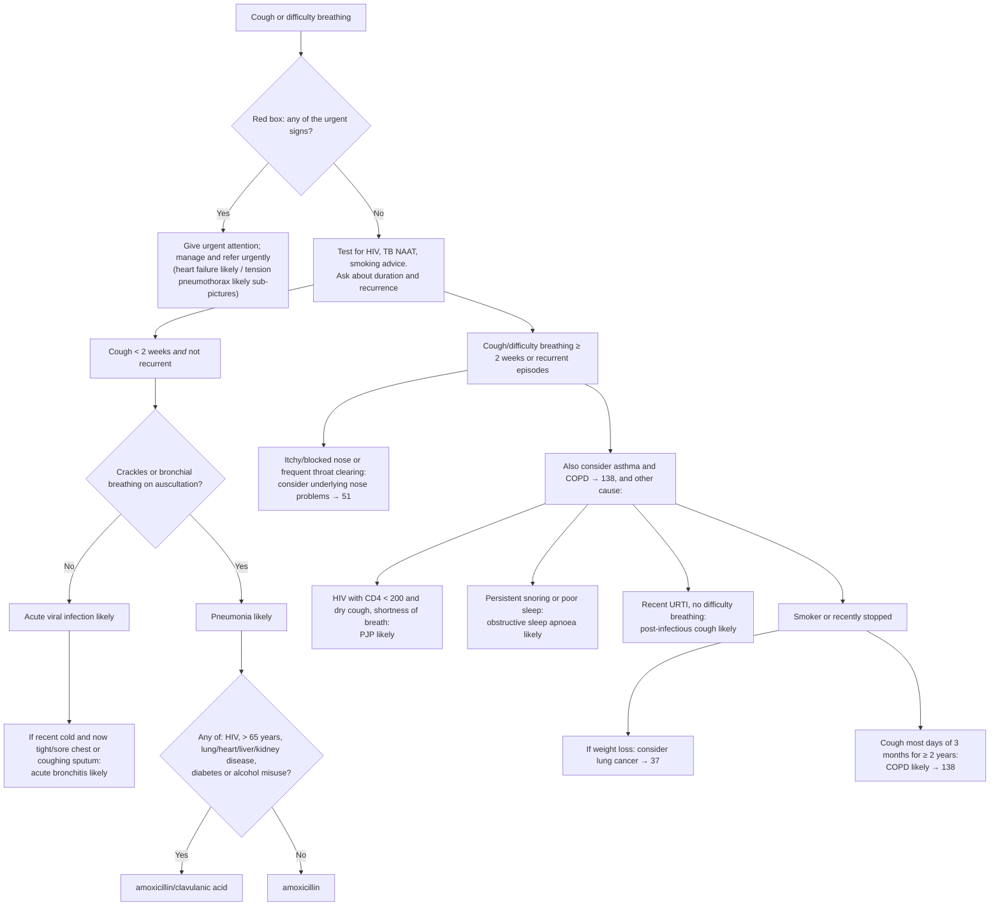

# Page 23 – Cough or difficulty breathing: flowchart

Source: APC 2026 e-book page 23. The red box is the urgent screen; the panel below
it ("Approach to the patient with cough or difficulty breathing not needing urgent attention") is a
two-branch algorithm on duration/recurrence.

## Decision nodes → rules

| Node | Modelled as | Rule |
|---|---|---|
| Presenting complaint | `Cough` or `Difficulty breathing` (descendants include the recorded common symptom `Dyspnea`) | `due_to` of both `check_for` tasks and of the priority rule |
| Red box, any item | `(and complaint (or …red-box items…))` | `Urgent: cough or difficulty breathing with red-box signs` |
| Heart failure likely | Orthopnea **and** swelling of lower limb | `Diagnose probable heart failure (cough/difficulty breathing page)` → `(active_condition Heart failure)` in the priority rule |
| Tension pneumothorax likely | Sudden-onset dyspnoea **and** a one-sided sign (hyperresonance / decreased breath sounds / chest pain, each `Unilateral`) **and** displaced trachea **and** BP < 90/60 | `Diagnose probable tension pneumothorax (cough/difficulty breathing page)` → `(active_condition Tension pneumothorax)` in the priority rule |
| Rapid deep breathing → glucose | not modelled: glucose is a routine vital (no `measure` task); "If > 11.1 → 19" is a cross-reference | — |
| Cough < 2 weeks and not recurrent | `(<= (onset Cough) (time_ago 2 weeks))` **and** `(no Cough + Recurrent)` | used inside the three short-cough rules |
| Crackles/bronchial breathing = No | `(no Respiratory crackles)` and `(no Bronchial breathing)` | `Diagnose probable acute viral infection (short cough, no crackles)` |
| Acute bronchitis likely | short-cough No-branch **and** common cold **and** (tight chest or chest pain or productive cough) | `Diagnose probable acute bronchitis (short cough, recent cold)` |
| Crackles/bronchial breathing = Yes | short-cough gate **and** (crackles or bronchial breathing) | `Diagnose probable pneumonia (short cough with crackles/bronchial breathing)` |
| Pneumonia risk question (antibiotic choice) | not modelled (management) | — |
| Cough/DB ≥ 2 weeks or recurrent | `or` of `(>= (onset Cough) (time_ago 2 weeks))`, `(>= (onset Difficulty breathing) (time_ago 2 weeks))`, recurrent cough, recurrent difficulty breathing | used inside every long-branch rule |
| Consider nose problems | long gate **and** (itching of nose, nasal congestion, throat clearing) | `Diagnose possible nose disorder (chronic or recurrent cough)` |
| Consider asthma and COPD | long gate | `Diagnose possible asthma (chronic or recurrent cough/difficulty breathing)`, `Diagnose possible COPD (chronic or recurrent cough/difficulty breathing)` |
| PJP likely | long gate **and** known HIV **and** dry cough **and** dyspnoea (CD4 < 200 not representable) | `Diagnose probable PJP (chronic cough with HIV)` |
| OSA likely | long gate **and** (habitual snoring or poor sleep pattern) | `Diagnose probable obstructive sleep apnoea (chronic cough page)` |
| Post-infectious cough likely | long gate **and** upper respiratory infection **and** `(no Difficulty breathing)` | `Diagnose probable post-infectious cough` |
| Consider lung cancer | long gate **and** (smoker or ex-smoker) **and** weight decreased | `Diagnose possible lung cancer (smoker with chronic cough and weight loss)` |
| COPD likely | (smoker or ex-smoker) **and** `(>= (onset Cough) (time_ago 2 years))` | `Diagnose probable COPD (smoker with cough for 2 years or more)` |

## Notes

- "< 2 weeks" is written `<=` and "≥ 2 weeks" `>=`, because onset comparisons accept only `>=`/`<=`;
  a cough of exactly 2 weeks therefore satisfies both gates.
- "Recent" (recent cold, recent URTI) is not modelled as a time comparison.
- Treatment boxes (antibiotics, paracetamol, co-trimoxazole, review/refer) are management and are not modelled.
