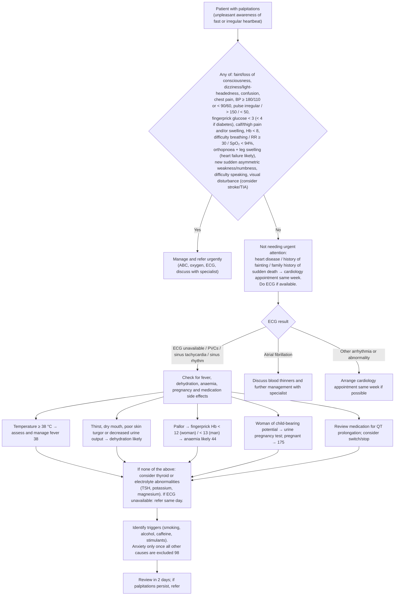

# Page 26 – Palpitations: flowchart

Source: APC 2026 e-book page 26. Red box, then the approach to the patient
with palpitations not needing urgent attention.

## Decision nodes → rules

| Node | Modelled as | Rule |
|---|---|---|
| Presenting complaint | `(clinical_finding Palpitations)` as the trigger | `Check for urgent palpitations conditions`, `Check for causes of palpitations` |
| Red box (any of) | `(and Palpitations (or …red box items…))` | `Urgent: palpitations with danger signs` |
| Orthopnoea + leg swelling → heart failure likely | `probable` Heart failure: Palpitations **and** Orthopnea **and** Leg swelling symptom | `Diagnose probable heart failure from palpitations` (referenced from the priority rule via `active_condition`) |
| New sudden asymmetric weakness/numbness, difficulty speaking, visual disturbance → consider stroke/TIA | `possible` Cerebrovascular accident and `possible` Transient ischemic attack, each Palpitations **and** any of the four sudden-onset findings | `Diagnose possible stroke from palpitations`, `Diagnose possible TIA from palpitations` |
| Hb < 8 | Not representable (no Hb unit/observable) | — |
| ECG branches (PVCs, sinus tachycardia, sinus rhythm, AF, other arrhythmia) | Not representable (no ECG result in the language) | — |
| Temperature ≥ 38 °C → fever 38 | Cross-reference to the fever page; temperature is a routine vital | — (used as an exclusion in the thyroid/electrolyte rules) |
| Thirst, dry mouth, poor skin turgor or decreased urine output → dehydration likely | `probable` Dehydration: Palpitations **and** any of the four | `Diagnose probable dehydration from palpitations` |
| Pallor → Hb → anaemia likely | Not representable (needs fingerprick Hb) | — |
| Pregnancy test → 175 | Not representable (urine test result) / cross-reference | — |
| Medication review (QT) | Management | — |
| None of the above → consider thyroid or electrolyte abnormalities | `possible` Disorder of thyroid gland and `possible` Electrolyte imbalance: Palpitations **and** temperature < 38 °C **and** (no) each dehydration sign | `Diagnose possible thyroid disorder from palpitations`, `Diagnose possible electrolyte imbalance from palpitations` |
| Anxiety only once all other causes excluded | Not encoded (exclusion of ECG, Hb, pregnancy and medication causes is not representable) | — |

## Notes

- The ECG, Hb, pregnancy-test and medication-review steps cannot be expressed, so the
  thyroid/electrolyte "none of the above" exclusion only covers fever and the dehydration signs.
- Cardiology/referral steps, oxygen and ECG instructions are management and are not modelled.
