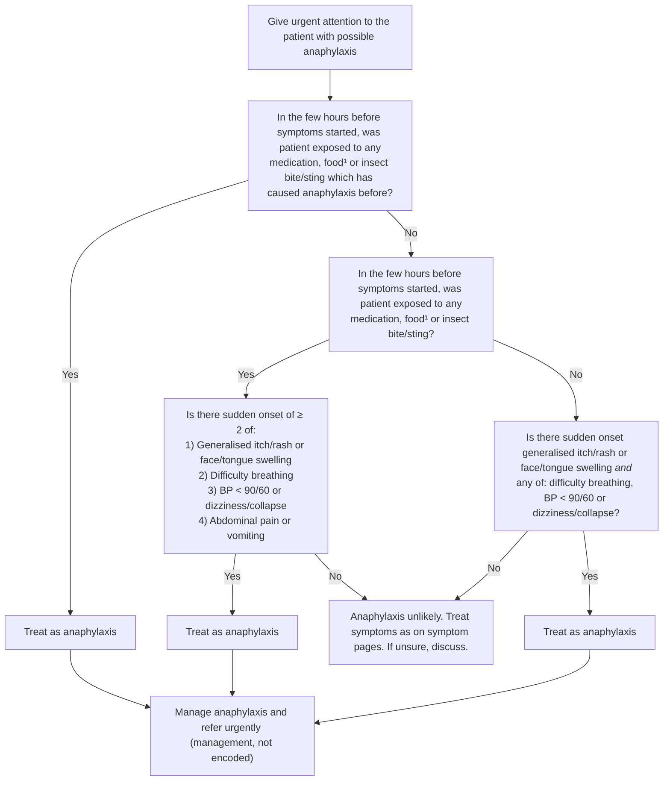
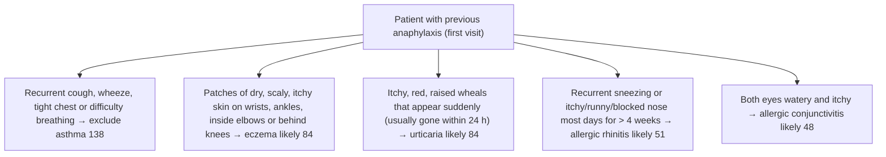

# Page 28 – Anaphylaxis (APC 2026): flowchart

Source: APC 2026 e-book page 28 (red box). The 2026 red-box algorithm is the same
shape as APC 2023 page 20.

¹ Common foods causing anaphylaxis include peanuts, tree nuts, egg, milk and fish.

Lower half of the page (not a flowchart, but it has "likely" logic), for the patient with
previous anaphylaxis, at first visit, row "Other allergy":

## Decision nodes → rules

| Node | Modelled as | Rule |
|---|---|---|
| Header: possible anaphylaxis (what makes us ask the questions) | Any sudden-onset skin sign alone, or `any2` of insect bite/sting, itch, rash, face/tongue swelling, difficulty breathing, dizziness, collapse, low BP (gold-standard pre-screen) | `Diagnose possible anaphylaxis` → triggers `Check for anaphylaxis` |
| Q1 = Yes | Exposure to a substance **and** a recorded allergy to the same substance (fish, milk, egg, peanut, tree nut, drug), or insect bite/sting **and** allergy to insect venom | `Diagnose probable anaphylaxis`, first seven `or` branches |
| Q1 = No → Q2 = Yes → Q3 = Yes | Any exposure (food, drug, insect bite/sting) **and** `any2` of the four symptom groups; sudden-onset qualifier on the skin group | `Diagnose probable anaphylaxis`, `(and (or exposures) (any2 …))` branch |
| Q2 = No → Q4 = Yes | Sudden-onset skin group **and** any of difficulty breathing, BP < 90/60, dizziness, collapse (no abdominal pain/vomiting, as the page says) | `Diagnose probable anaphylaxis`, last `and` branch |
| Q3 = No / Q4 = No | Anaphylaxis unlikely: no rule fires | (none; routing) |
| Treat as anaphylaxis | `(active_condition Anaphylaxis)` → Urgent | `Urgent: anaphylaxis` |
| Manage anaphylaxis and refer urgently | Management (adrenaline, oxygen, fluids, nebuliser, hydrocortisone, promethazine) | not encoded (no `manage` tasks in this pass) |
| A1 exclude asthma | Previous anaphylaxis **and** any recurrent cough / wheeze / tight chest / difficulty breathing | `Diagnose possible asthma in previous anaphylaxis` |
| A2 eczema likely | Previous anaphylaxis **and** scaly skin at wrist/ankle/cubital fossa/popliteal fossa **and** dry skin **and** itchy skin | `Diagnose probable eczema in previous anaphylaxis` |
| A3 urticaria likely | Previous anaphylaxis **and** sudden-onset wheal **and** itchy skin | `Diagnose probable urticaria in previous anaphylaxis` |
| A4 allergic rhinitis likely | Previous anaphylaxis **and** any of recurrent sneezing / itchy nose / nasal discharge / nasal congestion with onset > 4 weeks ago | `Diagnose probable allergic rhinitis in previous anaphylaxis` |
| A5 allergic conjunctivitis likely | Previous anaphylaxis **and** watery eye **and** itching of both eyes | `Diagnose probable allergic conjunctivitis in previous anaphylaxis` |
| Findings for A1–A5 | Checked for when history of anaphylaxis is recorded | `Assess the patient with previous anaphylaxis for other allergy` |

## Notes

- "In the few hours before symptoms started" is not modelled as a time comparison; exposures
  recorded in the current encounter are taken as recent (as in the gold standard).
- BP < 90/60 is read as systolic < 90 **or** diastolic < 60.
- "Generalised" (itch/rash) is not added as a qualifier, following the gold standard.
