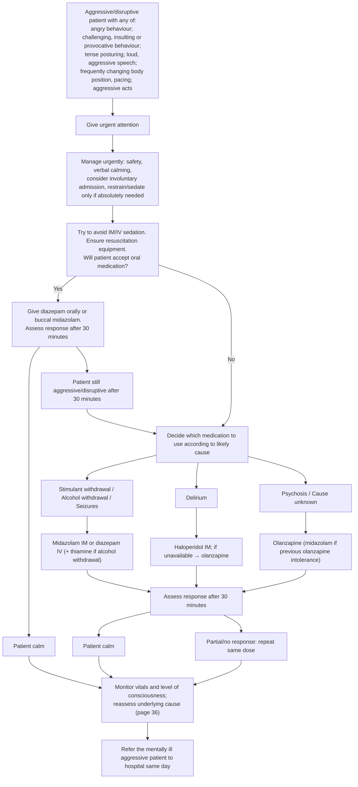

# Page 35 – Aggressive/disruptive behaviour: flowchart

Source: APC 2026 page 35 (APC 2026 e-book page 35, red box 1).

## Decision nodes → rules

| Node | Modelled as | Rule |
|---|---|---|
| Red box (complaint + any of six behaviours) | `(and (or Aggressive behavior, Disruptive behavior) (or …ten findings for the six items…))` | `Urgent: aggressive/disruptive patient with signs of escalating aggression`; findings asked by `Check for urgent aggressive/disruptive behaviour signs` |
| Will patient accept oral medication? (Yes/No) | Not modelled: management (sedation route) | — |
| Patient calm / still aggressive after 30 minutes | Not modelled: response to treatment | — |
| Likely cause (stimulant/alcohol withdrawal, seizures, delirium, psychosis, unknown) | Not modelled: the boxes choose a medicine; the page gives no criteria for diagnosing them | — |
| Repeat dose, monitoring, referral | Not modelled: management | — |
