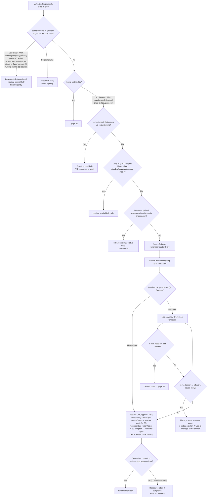

# Page 42 – Lump/swelling in neck, axilla or groin: flowchart

Source: APC 2026 e-book page 42. Red box at top; the "not needing urgent
attention" approach and lymphadenopathy work-up below it.

## Decision nodes → rules

| Node | Modelled as | Rule |
|---|---|---|
| Presenting complaint | `Mass of body region` (the recorded common symptom "Lump"); site recorded as `Mass of neck` / `Mass of axilla` / `Groin mass` | `Check for causes of lump/swelling in neck, axilla or groin` |
| Red box, lump in groin | `Groin mass` triggers the red-box check | `Check for urgent lump/swelling in groin conditions` |
| RB hernia branch | `Groin mass` **and** `Cough impulse of mass present` **and** any of `Severe pain`, vomiting, (constipation **and** unable to break wind, both onset ≥ 24 h), groin mass with `Irreducible` qualifier | `Diagnose probable incarcerated (irreducible) inguinal hernia, lump in groin`, `Diagnose probable strangulated inguinal hernia, lump in groin` |
| RB pulsating lump | `Groin mass` with `Pulsatile` qualifier | `Diagnose probable aneurysm, pulsating lump in groin` |
| Refer urgently | `Urgent` priority: groin mass **and** either hernia diagnosis or aneurysm | `Urgent: lump/swelling in groin with incarcerated/strangulated hernia or aneurysm` |
| Lump on the skin | `Mass of skin`: cross-reference only (page 89); used as an exclusion for lymphadenopathy | `Diagnose probable lymphadenopathy, lump in neck, axilla or groin` (as `(no …)`) |
| Thyroid mass | `Mass of neck` **and** `Thyroid gland moves with swallowing` | `Diagnose probable thyroid mass, lump in neck moving on swallowing` |
| Inguinal hernia | `Groin mass` **and** `Cough impulse of mass present` | `Diagnose probable inguinal hernia, lump in groin` |
| Hidradenitis suppurativa | recurrent abscess of axilla/groin/perineum, each paired with pain at that site | `Diagnose probable hidradenitis suppurativa, recurrent painful abscesses` |
| None of above → lymphadenopathy | lump in neck/axilla/groin **and** explicit absence of: skin mass, thyroid moving with swallowing, cough impulse, recurrent abscess at each of the three sites | `Diagnose probable lymphadenopathy, lump in neck, axilla or groin` |
| Consider mpox | `Lymphadenopathy` active **and** exposure to monkeypox virus **and** rash/lesion **and** ≥ 1 of the listed symptoms or temperature > 38.5 °C | `Diagnose possible mpox in lymphadenopathy (lump in neck, axilla or groin)`, fed by `Check for mpox features in lymphadenopathy (lump in neck, axilla or groin)` |
| Localised / generalised, hot and tender groin node (bubo), medication/infective cause, TB symptoms, refer same week / reassure | Routing and management; not modelled (see remaining questions) | — |
