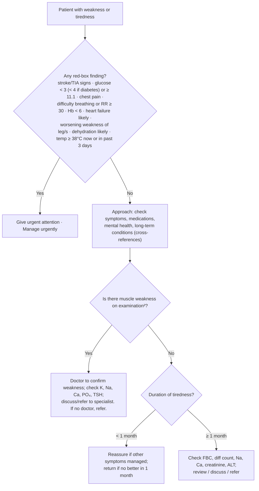

# Page 43 – Weakness or tiredness: flowchart

Source: APC 2026 e-book page 43 (APC 2026 page 43). The red box is a flat "any of" list; the lower
half of the page is a Yes/No and duration algorithm for the patient **not** needing urgent attention.

² If unsure how to examine for muscle weakness, discuss with doctor.

## Decision nodes → rules

| Node | Modelled as | Rule |
|---|---|---|
| Presenting complaint | `Fatigue` or `Asthenia` (weakness) as clinical findings | `Check for urgent weakness or tiredness conditions` (trigger) |
| Red box: stroke/TIA signs | Sudden-onset asymmetric weakness/numbness of face, upper limb, lower limb; difficulty talking or visual disturbance (no onset qualifier) | `Urgent: weakness or tiredness with red-box findings`; `Diagnose possible stroke (weakness or tiredness page)`; `Diagnose possible TIA (weakness or tiredness page)` |
| Red box: glucose | Glucose < 3, or < 4 with known diabetes, or ≥ 11.1 mmol/L | `Urgent: weakness or tiredness with red-box findings` |
| Red box: chest pain; difficulty breathing or RR ≥ 30 | Findings / vital | `Urgent: weakness or tiredness with red-box findings` |
| Red box: Hb < 6 | Not representable (no Hb observable/unit) | — |
| Red box: heart failure likely | Orthopnoea **and** leg swelling → probable heart failure | `Diagnose probable heart failure (weakness or tiredness page)` → `(active_condition Heart failure)` in the urgent rule |
| Red box: worsening weakness of leg/s | Lower-limb muscle weakness with `Worsening` qualifier | `Urgent: weakness or tiredness with red-box findings` |
| Red box: dehydration likely | Any of thirst, dry mouth, decreased skin turgor, BP < 90/60 → probable dehydration | `Diagnose probable dehydration (weakness or tiredness page)` → `(active_condition Dehydration)` in the urgent rule |
| Red box: temperature | Temp ≥ 38 °C, or active fever | `Urgent: weakness or tiredness with red-box findings` |
| Muscle weakness on examination? Yes/No | Routing to doctor/investigations only; no diagnosis or priority | Not encoded (management) |
| Duration < 1 month / ≥ 1 month | Routing to reassurance/investigations only | Not encoded (management) |

## Notes

- The non-urgent half of the page ends only in investigations, referral, reassurance and
  cross-references; it names no "likely" diagnosis that the language can express (the only one,
  "anaemia likely" from Hb < 12/13, needs a haemoglobin value).

Every diagnosis rule above also requires the complaint (Fatigue or Asthenia), because the red box
applies to "the patient with weakness or tiredness".
