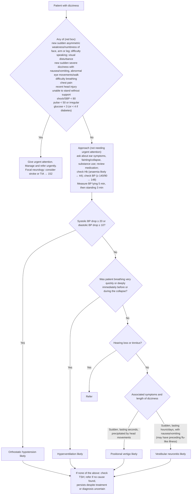

# Page 46 – Dizziness: flowchart

Source: APC 2026 e-book page 46.

## Decision nodes → rules

| Node | Modelled as | Rule |
|---|---|---|
| Patient with dizziness | `(clinical_finding Dizziness)` (a recorded common symptom) | trigger of `Check for urgent dizziness conditions`, `Check for causes of dizziness not needing urgent attention`, `Measure lying and standing BP for dizziness` |
| Red box (any of) | `(and Dizziness (or …red box items…))` | `Urgent: dizziness with danger signs` |
| Red box, focal neurology: "consider stroke or TIA" | `possible` stroke and `possible` TIA from dizziness plus any sudden-onset focal sign | `Diagnose possible stroke with dizziness`, `Diagnose possible TIA with dizziness` |
| Anaemia likely (Hb) | Not modelled: haemoglobin has no observable/unit in the language | none |
| Measure BP lying and standing | `measure` task for lying and standing systolic/diastolic BP | `Measure lying and standing BP for dizziness` |
| Q1: BP drop on standing → Orthostatic hypotension likely | **Not modelled**: the language cannot compare two measurements (a drop) | none |
| Q2 = Yes → Hyperventilation likely | Collapse **and** (tachypnoea **or** excessively deep breathing) | `Diagnose probable hyperventilation with dizziness` |
| Q2 = No → Q3 | `(not (and Collapse (or Tachypnea, Excessively deep breathing)))` | exclusion in the two vertigo rules |
| Q3 = Yes → Refer | Referral only (no diagnosis); hearing loss / tinnitus used as `(no …)` | exclusion in the two vertigo rules |
| Q4 → Positional vertigo likely | Sudden-onset positional vertigo, no hearing loss, no tinnitus, not the hyperventilation branch | `Diagnose probable positional vertigo with dizziness` |
| Q4 → Vestibular neuronitis likely | Sudden-onset dizziness with onset at least 1 hour ago **and** nausea or vomiting, no hearing loss, no tinnitus, not the hyperventilation branch | `Diagnose probable vestibular neuronitis with dizziness` |
| If none of the above / refer | Management | none |

## Notes

- Q1 (orthostatic drop) cannot be expressed, so the Q2 and Q4 rules do not exclude patients
  with an orthostatic drop; they may fire more often than the page intends.
- "Lasting seconds" (positional vertigo) cannot be expressed; "lasting hours/days" (vestibular
  neuronitis) is approximated as onset at least 1 hour ago.
