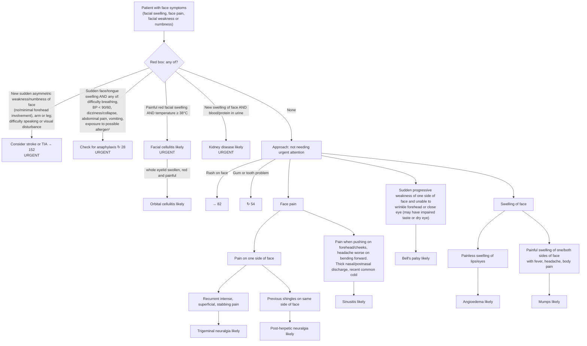

# Page 49 – Face symptoms: flowchart

Source: APC 2026 e-book page 49: the red box, then the "Approach to patient
with face symptoms not needing urgent attention" tree.

¹ Common allergens include medication, food or insect bite/sting within the past few hours.

## Decision nodes → rules

| Node | Modelled as | Rule |
|---|---|---|
| Patient with face symptoms | `or` of Swelling (face), Pain in face, Weakness of face muscles, Numbness of face, Lip swelling, Swelling around eyes | due_to of `Check for urgent face symptom conditions`; first `and` arm of `Urgent: face symptoms with stroke, anaphylaxis, facial cellulitis or kidney disease signs` |
| Stroke/TIA bullet | Sudden-onset unilateral face weakness with no upper facial (forehead) weakness, or sudden-onset unilateral face numbness, limb weakness or limb numbness, or difficulty talking, or visual disturbance | `Diagnose possible stroke from face symptoms`, `Diagnose possible TIA from face symptoms`, and the priority rule |
| Anaphylaxis bullet | Sudden-onset face or tongue swelling **and** any of difficulty breathing, SBP < 90 / DBP < 60, dizziness, collapse, abdominal pain, vomiting, exposure to drug/food, insect bite/sting | `Diagnose possible anaphylaxis from face swelling` and the priority rule |
| Facial cellulitis bullet | Facial swelling **and** pain in face **and** redness of skin of face **and** temperature ≥ 38 °C | `Diagnose probable facial cellulitis`; priority via `(active_condition Cellulitis of face)` |
| Orbital cellulitis | Facial cellulitis evidence **and** eyelid swelling, eyelid erythema, eyelid pain | `Diagnose probable orbital cellulitis from facial cellulitis` |
| Kidney disease bullet | New facial swelling **and** (blood in urine **or** proteinuria) | `Diagnose probable kidney disease from facial swelling`; priority via `(active_condition Kidney disease)` |
| Rash on face → 82, gum/tooth → 54 | Cross-references only | not encoded |
| Face pain → one side → recurrent stabbing | Pain in face (unilateral) **and** stabbing pain of face (recurrent, severe) | `Diagnose probable trigeminal neuralgia` |
| Face pain → one side → previous shingles | Pain in face (unilateral) **and** history of herpes zoster | `Diagnose probable post-herpetic neuralgia` |
| Face pain → sinus features | Pain in face **and** tenderness of face **and** headache **and** (thick nasal discharge **or** posterior rhinorrhea) **and** recent common cold | `Diagnose probable sinusitis from face pain` |
| Facial weakness → Bell's palsy | Sudden-onset unilateral face weakness **and** (upper facial weakness **or** unable to close eyes) | `Diagnose probable Bell's palsy` |
| Swelling → painless lips/eyes | Painless lip swelling **or** painless swelling around eyes | `Diagnose probable angioedema from face swelling` |
| Swelling → painful with fever, headache, body pain | Facial swelling **and** pain in face **and** fever **and** headache **and** generalised aches and pains | `Diagnose probable mumps from painful face swelling` |

## Notes

- The "not needing urgent attention" tree is reached only when no red-box item applies. The rules
  do not add `(no …)` guards for the red-box items to the non-urgent diagnoses; overlapping
  diagnoses (e.g. mumps and facial cellulitis) can both fire.
- The forehead distinction between stroke (no/minimal forehead involvement) and Bell's palsy
  (unable to wrinkle forehead) is modelled with `Upper facial weakness`.
