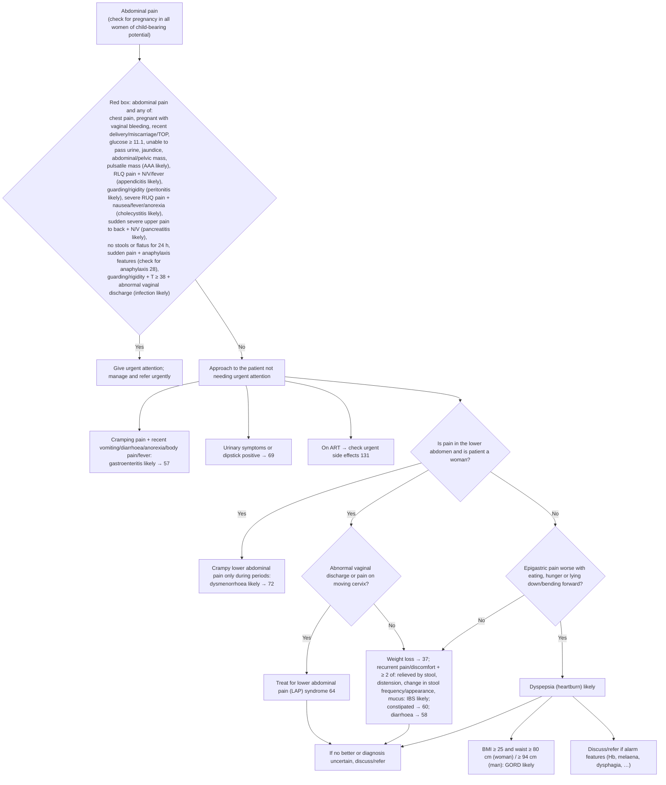

# Page 56 – Abdominal pain: flowchart (APC 2026, final reconciled build)

Source: APC 2026 e-book page 56 (red box and the "Approach to the patient with abdominal pain not
needing urgent attention" algorithm below it).

## Decision nodes → rules

| Node | Modelled as | Rule |
|---|---|---|
| Red box trigger | `(clinical_finding Abdominal pain)` (a recorded warning sign) | `Check for urgent abdominal pain conditions` |
| Pulsatile abdominal mass | `Pulsatile mass of abdomen` | `Diagnose probable abdominal aortic aneurysm from abdominal pain` |
| RLQ pain + nausea/vomiting/fever | `Right lower quadrant pain` and (`Nausea` or `Finding of vomiting` or `(active_condition Fever)`) | `Diagnose probable appendicitis from abdominal pain` |
| Guarding or rigidity | `Abdominal guarding` or `Abdominal rigidity` | `Diagnose probable peritonitis from abdominal pain` |
| Severe RUQ pain + nausea/fever/loss of appetite | `Right upper quadrant pain` + Severe, and any of the three | `Diagnose probable cholecystitis from abdominal pain` |
| Sudden severe upper pain to back + N/V | `Upper abdominal pain` + Sudden onset + Severe, radiating to the back (lumbar or left/right thoracic radiation), and nausea or vomiting | `Diagnose probable pancreatitis from abdominal pain` |
| Guarding/rigidity + T ≥ 38 °C + abnormal vaginal discharge | (guarding or rigidity) and temperature ≥ 38 and `Vaginal discharge problem` | `Diagnose probable infection from abdominal pain with guarding, fever and vaginal discharge` (`Infectious disease`); its evidence is inlined in the priority rule |
| Sudden abdominal pain + anaphylaxis features | sudden-onset abdominal pain and any of the listed features or exposures | `Diagnose possible anaphylaxis from sudden abdominal pain` (feeds page 28/20 anaphylaxis check) and a branch of the priority rule |
| Red box = Yes | `(and Abdominal pain (or …))` | `Urgent: abdominal pain with red-box signs` |
| Gastroenteritis likely | `Abdominal colic` and any of vomiting, diarrhoea, loss of appetite, generalised aches, fever | `Diagnose probable gastroenteritis from abdominal pain` |
| Dysmenorrhoea likely | `Abdominal colic` at lower abdomen, qualifier `During menstruation` | `Diagnose probable dysmenorrhoea from abdominal pain` |
| Abnormal discharge or cervical excitation → LAP syndrome | Not encoded: no SNOMED concept for LAP syndrome (routing to page 64) | – |
| Q2 = Yes: dyspepsia likely | epigastric pain postprandial, or epigastric pain with hunger pain or positional aggravation | `Diagnose probable dyspepsia from abdominal pain` |
| GORD likely | dyspepsia evidence and BMI ≥ 25 and waist ≥ 80 cm (sex not modelled) | `Diagnose probable GORD from dyspepsia with raised BMI and waist`; waist via `Measure waist circumference and BMI for dyspepsia` |
| IBS likely | recurrent pain/discomfort and `any2` of distension, change in stool frequency/appearance, mucus | `Diagnose probable irritable bowel syndrome from abdominal pain` |
| Urinary, ART, weight loss, constipation, diarrhoea pointers | cross-references to other pages | – |

## Notes

- "Is patient a woman?" and the sex-specific waist cut-offs cannot be expressed (no sex predicate).
- The Yes/No routing between branches is not enforced; each "likely" rule fires on its own evidence.
