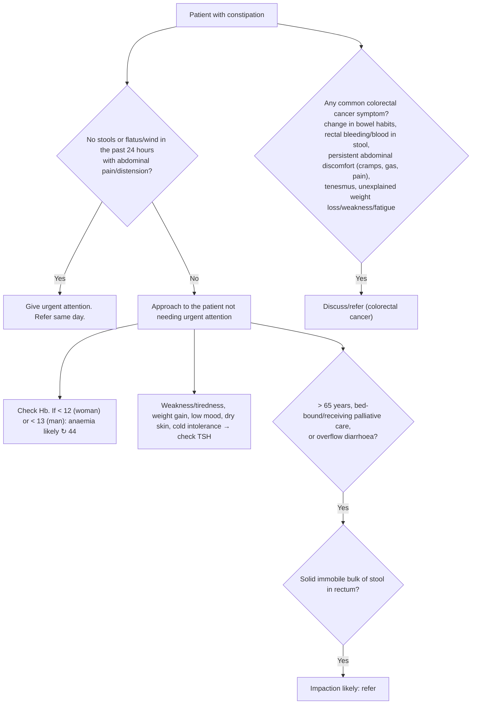

# Page 60 – Constipation: flowchart

Source: APC 2026 e-book page 60. The page has no drawn flowchart; this
traces its red box and its multi-step "if … check … if present, X likely" bullets.

## Decision nodes → rules

| Node | Modelled as | Rule |
|---|---|---|
| Patient with constipation | `(clinical_finding Constipation)`, a recorded common symptom | trigger of `Check for urgent constipation conditions` and `Check for colorectal cancer symptoms in constipation` |
| Urgent box | Constipation **and** Obstipation with onset ≥ 24 hours ago **and** Unable to break wind with onset ≥ 24 hours ago **and** (abdominal pain **or** distension of abdomen) | `Urgent: constipation with no stools or flatus for 24 hours` |
| Anaemia (Hb) | Not modelled: Hb has no observable/unit in the language | none |
| TSH bullet | Not modelled: TSH is a lab value with no unit; no diagnosis is named | none |
| Impaction gate | Constipation **and** (bed-ridden **or** seen by palliative care service **or** chronic constipation with overflow). "> 65 years" cannot be expressed | `Check for faecal impaction in constipation` (task), and the gate inside `Diagnose probable faecal impaction` |
| Bulk of stool in rectum → impaction likely | Hard stool with finding site rectum, plus the gate | `Diagnose probable faecal impaction` |
| Colorectal cancer symptoms | Any of the listed symptoms in a constipated patient → `possible` colorectal cancer | `Diagnose possible colorectal cancer in constipation` |
| Treat / advise sections | Management | none |
