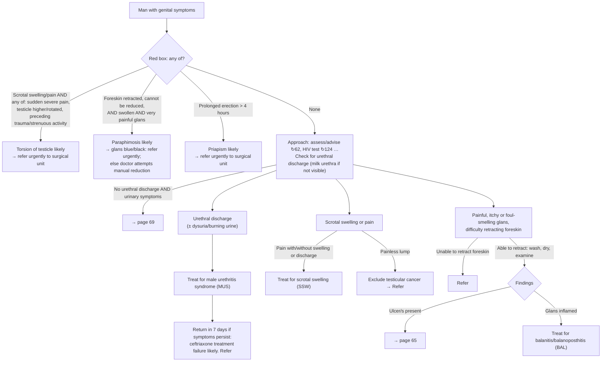

# Page 63 – Genital symptoms in a man: flowchart

Source: APC 2026 e-book page 63 (APC 2026 e-book, page 63). Red box at top; below it an
"Approach to the man with genital symptoms not needing urgent attention" with three columns.

## Decision nodes → rules

| Node | Modelled as | Rule |
|---|---|---|
| Trigger: man with genital symptoms | `Male genitalia finding` (descendants match) or `Urethral discharge` | `Check for urgent genital symptoms in a man` (task) |
| Torsion of testicle likely | (Swelling of scrotum or Pain in scrotum) **and** any of: sudden-onset severe scrotal pain, Testicle out of place, Testes - transverse lie, Traumatic injury, Injury of scrotum, Injury of testis, Overexertion and strenuous movements | `Diagnose probable torsion of testis (genital symptoms in a man)` |
| Paraphimosis likely | Fixed, retracted foreskin **and** swelling of glans **and** severe pain of glans | `Diagnose probable paraphimosis (genital symptoms in a man)` |
| Priapism likely | Onset of prolonged erection of penis at least 4 hours ago | `Diagnose probable priapism (genital symptoms in a man)` |
| Red box → urgent attention | Genital symptom **and** any of the three likely diagnoses | `Urgent: genital symptoms in a man with torsion, paraphimosis or priapism` |
| Urethral discharge → treat for MUS | Urethral discharge → probable Urethritis (judgment call: "Treat for" read as the syndromic diagnosis) | `Diagnose probable male urethritis syndrome (genital symptoms in a man)` |
| Painless lump → exclude testicular cancer | Painless mass of scrotum or of testicle → possible Malignant neoplasm of testis | `Diagnose possible testicular cancer (painless scrotal lump)` |
| Glans inflamed → treat for BAL | Inflammatory morphology at glans penis → probable Balanitis (Balanoposthitis is a descendant) | `Diagnose probable balanitis/balanoposthitis (genital symptoms in a man)` |
| Pain ± swelling/discharge → treat for SSW | Not modelled: no SNOMED concept for the syndromic "scrotal swelling" diagnosis | — (see remaining questions) |
| Ulcer/s → page 65; no discharge + urinary symptoms → page 69; unable to retract → refer | Routing / management only | — |

## Notes

- "Not needing urgent attention" (the gate before the three columns) is not encoded as a negation in
  the MUS/BAL/cancer rules; they fire regardless of the red box.
- "Glans blue/black" only changes management of paraphimosis; not modelled.
- "Ceftriaxone treatment failure likely" depends on persistence after treatment, which the language
  cannot express.
