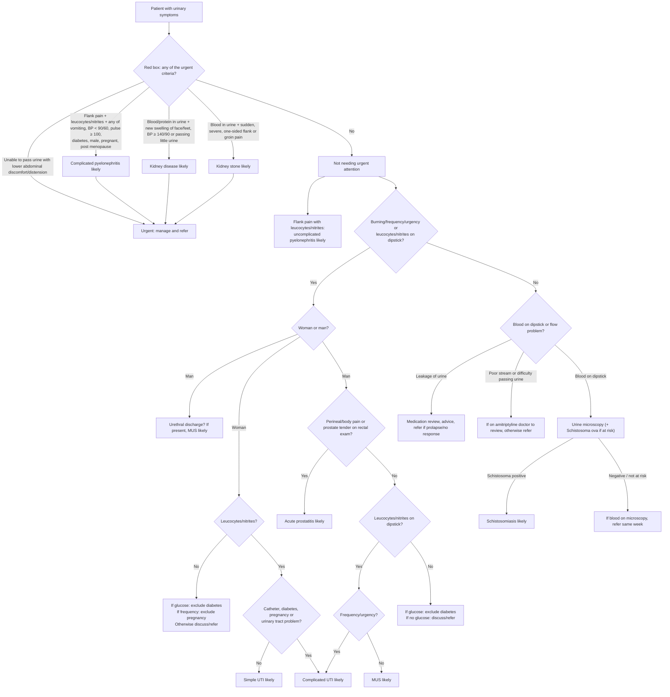

# Page 69 – Urinary symptoms: flowchart

Source: APC 2026 e-book page 69. The red box is a list of urgent criteria; the
lower half ("Approach to the patient with urinary symptoms not needing urgent attention") is a
branching algorithm.

## Decision nodes → rules

| Node | Modelled as | Rule |
|---|---|---|
| Presenting complaint | `Urinary symptoms` (finding) | `Check for urgent urinary symptom conditions` (red box) and `Check for urinary infection features` (approach below it), both triggers |
| Red box: unable to pass urine with lower abdominal discomfort/distension | `Unable to void urine` **and** (abdominal discomfort or distension, site lower abdomen) | `Urgent: urinary symptoms with danger signs`, first branch |
| Red box: complicated pyelonephritis likely | Flank pain **and** (leucocytes or nitrites) **and** any of the seven factors | `Diagnose probable complicated pyelonephritis (urinary symptoms)`; priority uses the criteria directly (see remaining questions) |
| Red box: kidney disease likely | (Blood in urine or proteinuria) **and** (new face/foot swelling, SBP ≥ 140 or DBP ≥ 90, oliguria) | `Diagnose probable kidney disease (urinary symptoms)` → `(active_condition Kidney disease)` in the priority rule |
| Red box: kidney stone likely | Blood in urine **and** sudden, severe, unilateral flank pain or inguinal pain | `Diagnose probable kidney stone (urinary symptoms)` → `(active_condition Kidney stone)` in the priority rule |
| Uncomplicated pyelonephritis likely | Flank pain **and** (leucocytes or nitrites) | `Diagnose probable uncomplicated pyelonephritis (urinary symptoms)` |
| Burning/frequency/urgency, woman/man, glucose, catheter/diabetes/pregnancy/urinary tract problem, urethral discharge, perineal/body pain, prostate tenderness | Findings checked for | `Check for urinary infection features` |
| Woman, leucocytes/nitrites, no complicating factor → Simple UTI likely | Female **and** (leucocytes or nitrites) **and** no catheter, diabetes, pregnancy or urinary system disorder | `Diagnose probable simple UTI in a woman (urinary symptoms)` |
| Woman, leucocytes/nitrites, complicating factor → Complicated UTI likely | Female **and** (leucocytes or nitrites) **and** any of the four factors | `Diagnose probable complicated UTI (urinary symptoms)`, woman branch |
| Man, no prostatitis signs, leucocytes/nitrites, frequency/urgency → Complicated UTI likely | Male, no perineal/body pain, prostate not tender, (leucocytes or nitrites), (frequency or urgency) | `Diagnose probable complicated UTI (urinary symptoms)`, man branch |
| Man: urethral discharge → MUS likely | Male, gate, urethral discharge | `Diagnose probable male urethritis syndrome (urinary symptoms)`, first branch |
| Man, no prostatitis signs, leucocytes/nitrites, no frequency/urgency → MUS likely | Male, no perineal/body pain, prostate not tender, (leucocytes or nitrites), no frequency, no urgency | `Diagnose probable male urethritis syndrome (urinary symptoms)`, second branch |
| Man: perineal/body pain or prostate tender → Acute prostatitis likely | Male, gate, (perineal pain or generalised aches and pains or prostate tenderness) | `Diagnose probable acute prostatitis (urinary symptoms)` |
| No leucocytes/nitrites + glucose → exclude diabetes (woman and man) | Gate by burning/frequency/urgency, no leucocytes, no nitrites, glycosuria (man: also no prostatitis signs) | `Diagnose possible diabetes (urinary symptoms with glycosuria)` |
| Woman, no leucocytes/nitrites + frequency → exclude pregnancy | Female, no leucocytes, no nitrites, increased frequency | `Diagnose possible pregnancy (urinary frequency)` |
| Schistosoma positive → Schistosomiasis likely | Not modelled: a positive *Schistosoma* ova result has no recordable finding | – (see remaining questions) |
| Discuss/refer, microscopy, leakage of urine, poor stream | Management or routing only | – |

## Notes

- "Burning" is read as `Dysuria`, "frequency" as `Increased frequency of urination`, "urgency" as
  `Urgent desire to urinate`.
- "Leucocytes/nitrites" is `Leukocytes in urine` **or** `Nitrite detected in urine`; "no
  leucocytes/nitrites" is `(no …)` of both.
- BP < 90/60 is systolic < 90 **or** diastolic < 60; BP ≥ 140/90 is systolic ≥ 140 **or** diastolic ≥ 90.
