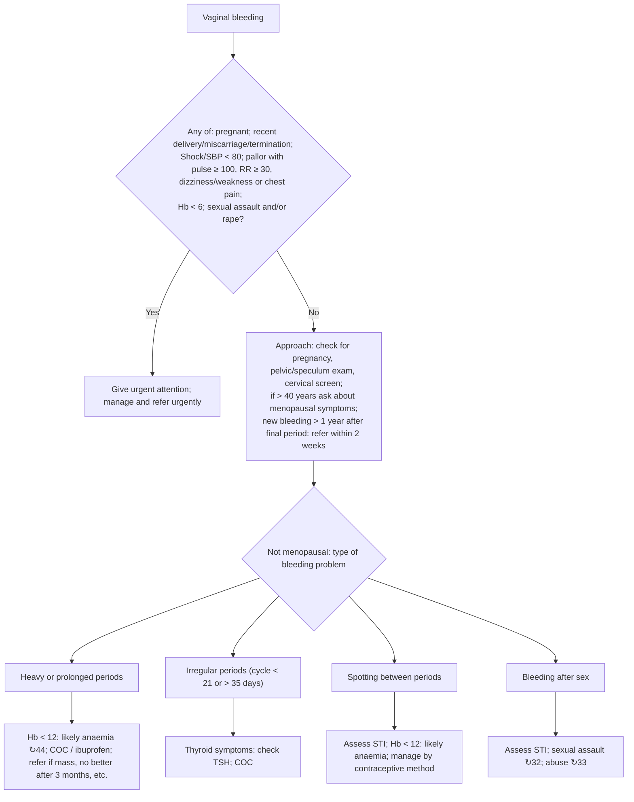

# Page 73 – Abnormal vaginal bleeding: flowchart

Source: APC 2026 e-book page 73 (red box plus the "not needing urgent attention" approach).

## Decision nodes → rules

| Node | Modelled as | Rule |
|---|---|---|
| Vaginal bleeding (trigger) | `(clinical_finding "Bleeding from vagina")` | `Check for urgent abnormal vaginal bleeding conditions` |
| Red box = Yes | `(and bleeding (or pregnancy, postpartum, recent miscarriage, recent termination, shock, SBP < 80, (and pallor (or pulse ≥ 100, RR ≥ 30, dizziness, asthenia, chest pain)), victim of sexual aggression, victim of rape))`. Hb < 6 not representable | `Urgent: abnormal vaginal bleeding with danger signs` |
| Approach / type of bleeding problem | Not modelled: management, examinations, investigations and referral only | — |
| Hb < 12: likely anaemia | Not modelled: needs a haemoglobin value | — |
