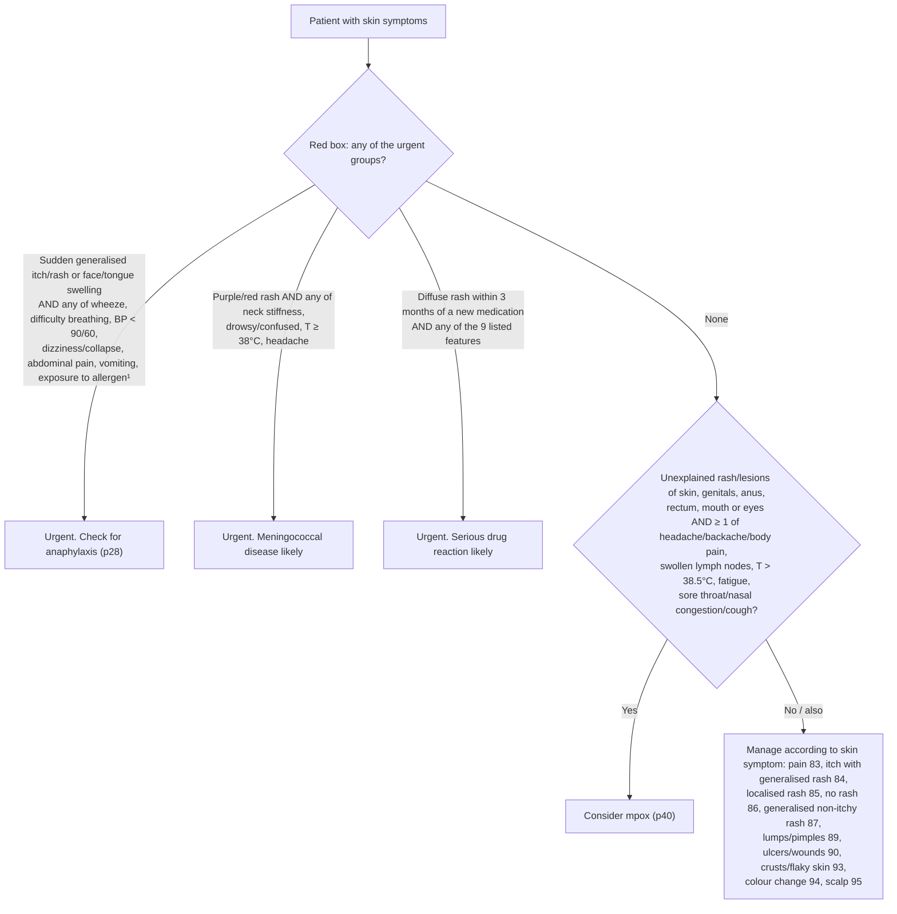

# Page 82 – Skin symptoms: flowchart

Source: APC 2026 e-book page 82 (red box, the "approach" section and the routing tree below it).

## Decision nodes → rules

| Node | Modelled as | Rule |
|---|---|---|
| Patient with skin symptoms | `(or (clinical_finding Skin finding) (clinical_finding Itching))` trigger (descendants match) | `Check for urgent skin symptom conditions`, `Check for mpox features with skin symptoms` |
| Anaphylaxis group | `(and (or sudden-onset itch/rash/face swelling/tongue swelling) (or wheeze, difficulty breathing, SBP<90, DBP<60, dizziness, collapse, abdominal pain, vomiting, exposure to drug/food, insect bite/sting))` | `Diagnose possible anaphylaxis from skin symptoms`; `Urgent: skin symptoms with features of anaphylaxis` |
| Meningococcal group | `(and (or Purpuric rash, Erythematous rash) (or Stiff neck, Drowsy, Acute confusion, T ≥ 38, Headache))` | `Diagnose probable meningococcal disease from purple/red rash`; `Urgent: skin symptoms with meningococcal disease likely` |
| Serious drug reaction group | `(and Generalized rash (<= (onset New medication commenced) (time_ago 3 months)) (or …9 features…))` | `Diagnose probable serious drug reaction with diffuse rash`; `Urgent: skin symptoms with serious drug reaction likely` |
| Consider mpox | `(and (or rash/lesion sites) (or ≥1 systemic feature))` | `Diagnose possible mpox from skin symptoms` |
| Routing tree to pages 83–95 | Not modelled: routing to other pages' own rules | — |
