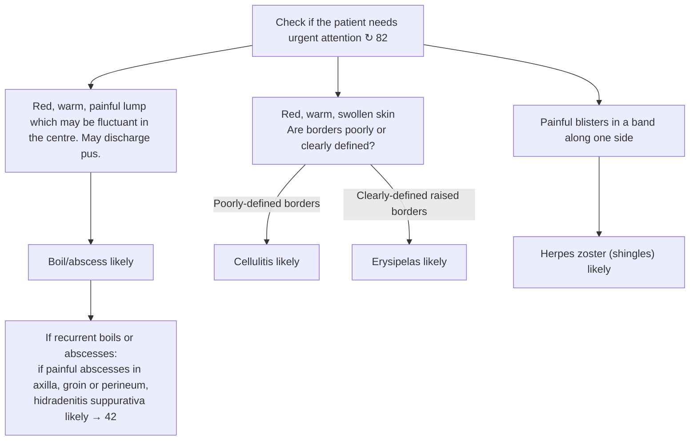

# Page 83 – Painful skin: flowchart

Source: APC 2026 e-book page 83. The red box is a pointer only ("Check if the patient needs urgent attention ↻ 82").

## Decision nodes → rules

| Node | Modelled as | Rule |
|---|---|---|
| Presenting complaint | `Pain of skin` (page title) | `Check for painful skin conditions` (trigger) |
| Red, warm, painful lump | Pain of skin **and** Mass of skin **and** Erythema **and** Warm skin; fluctuance/pus optional ("may") | `Diagnose probable boil/abscess (painful skin)` |
| Recurrent → axilla/groin/perineum | Pain of skin **and** Recurrent abscess of skin at axilla, inguinal region or perineum | `Diagnose probable hidradenitis suppurativa (painful skin)` |
| Borders poorly defined | Pain of skin **and** Erythema (Poorly defined) **and** Warm skin **and** Swelling of skin | `Diagnose probable cellulitis (painful skin)` |
| Borders clearly defined, raised | Pain of skin **and** Erythema (Well defined, Raised) **and** Warm skin **and** Swelling of skin | `Diagnose probable erysipelas (painful skin)` |
| Painful blisters in a band along one side | Pain of skin **and** Blister of skin, Zosteriform, Unilateral | `Diagnose probable herpes zoster (painful skin)` |

## Notes

- All treatment, "Refer same day if" lists and HIV/diabetes testing are management and are not modelled.
- "If infected (skin red, warm, swollen)" in the shingles panel governs antibiotics only; not modelled.
