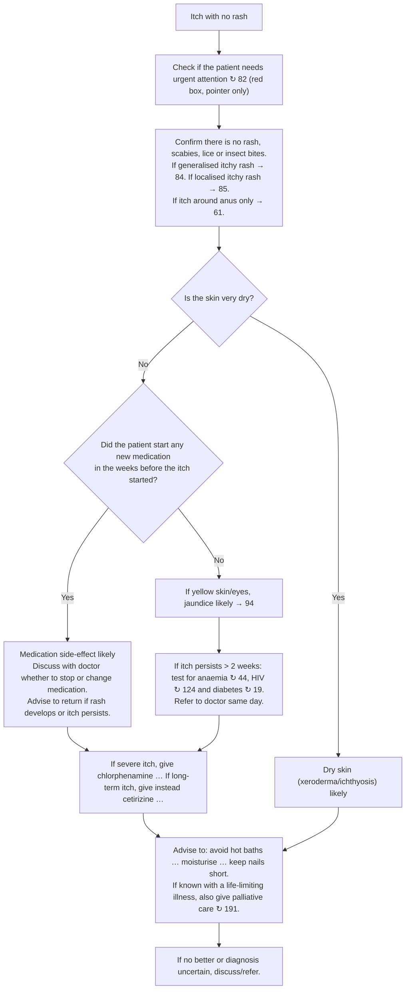

# Page 86 – Itch with no rash: flowchart

Source: APC 2026 e-book page 86. The red box is a pointer only
("Check if the patient needs urgent attention ↻ 82"); the diagnostic logic is the flowchart below it.

## Decision nodes → rules

| Node | Modelled as | Rule |
|---|---|---|
| Presenting complaint | `(clinical_finding Itching)` triggers the check-for task | `Check for causes of itch with no rash` |
| Red box ↻ 82 | Pointer only; no rule on this page | — (`cross_reference_only`) |
| Confirm no rash, scabies, lice or insect bites | Each is checked for, and each "likely" rule requires `(no …)` of all four, since the flowchart is entered only after they are excluded | All three diagnosis rules |
| → 84 / → 85 / → 61 | Routing to other pages; not modelled | — (`flowchart_routing`) |
| Q1 = Yes | `Severe dry skin` | `Diagnose probable dry skin in itch with no rash` (Xeroderma, probable) |
| Q1 = No → Q2 = Yes | `(no Severe dry skin)` and `New medication commenced` | `Diagnose probable medication side-effect in itch with no rash` (Adverse reaction caused by drug, probable) |
| Q1 = No → Q2 = No → yellow skin/eyes | `(no Severe dry skin)`, `(no New medication commenced)` and (`Yellow skin` or `Scleral icterus`) | `Diagnose probable jaundice in itch with no rash` (Jaundice, probable) |
| Itch persists > 2 weeks | Tests and same-day referral are management; not modelled | — (`management_step`) |
| Symptomatic treatment, advice, palliative care, discuss/refer | Management; not modelled | — (`management_step`) |

## Notes

- "In the weeks before the itch started" (Q2) cannot be expressed: the language compares an onset
  with a time ago, not two onsets with each other. The rule accepts any recorded new medication.
- "Very dry" is read as the precoordinated `Severe dry skin`.
