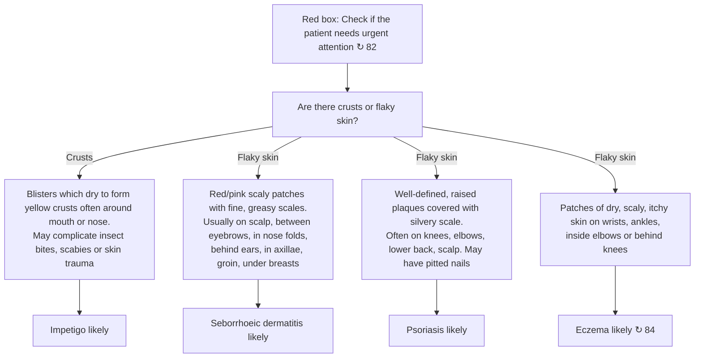

# Page 93 – Crusts or flaky skin: flowchart

Source: APC 2026 e-book page 93. The red box is a pointer only ("Check if the patient
needs urgent attention ↻ 82"); the triage is on page 82. The rest of the page is a descriptive
algorithm leading to four "likely" diagnoses.

## Decision nodes → rules

| Node | Modelled as | Rule |
|---|---|---|
| Red box (pointer to 82) | Not modelled here; cross-reference only | — |
| Are there crusts or flaky skin? | `Crust on skin` or `Scaly skin` recorded | `Check for causes of crusts or flaky skin` (trigger) |
| Crusts → blisters drying to yellow crusts | Blister of skin **and** crust on skin (yellow colour) | `Diagnose probable impetigo (crusts or flaky skin)` |
| Flaky → red/pink scaly patches with greasy scales | Scaly skin **and** erythema **and** greasy skin | `Diagnose probable seborrhoeic dermatitis (crusts or flaky skin)` |
| Flaky → well-defined raised plaques with silvery scale | Skin plaque (well defined, raised) **and** scaly skin (silver colour) | `Diagnose probable psoriasis (crusts or flaky skin)` |
| Flaky → dry, scaly, itchy patches on wrists/ankles/inside elbows/behind knees | Scaly skin at one of the four sites **and** xeroderma **and** itching of skin | `Diagnose probable eczema (crusts or flaky skin)` |

## Notes

- Locations introduced by "often" / "usually" (mouth or nose; scalp, eyebrows, nose folds, ears,
  axillae, groin, under breasts; knees, elbows, lower back, scalp) and "may" features (insect
  bites, scabies, skin trauma; pitted nails) are descriptive, not required; they are not criteria.
- The eczema sites are stated without a hedge ("on wrists, ankles, inside elbows or behind knees"),
  so they are required.
