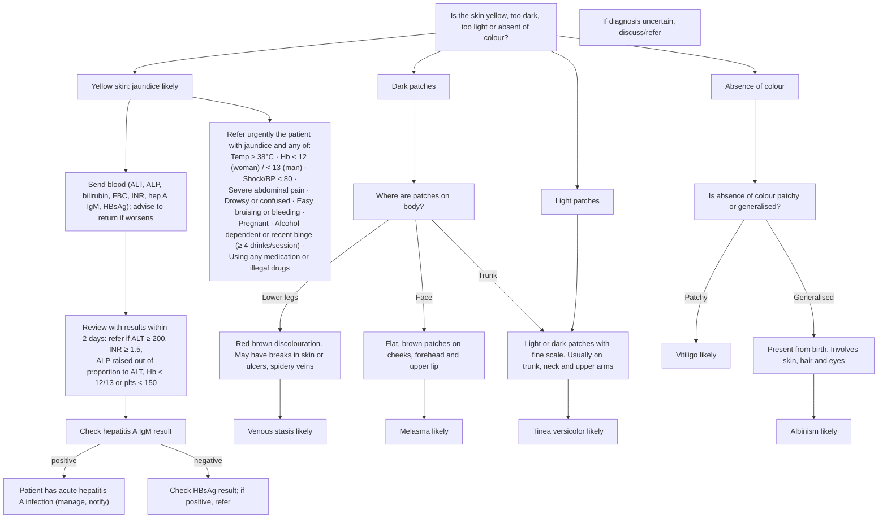

# Page 94 – Changes in skin colour: flowchart

Source: APC 2026 e-book page 94 (APC 2026 e-book, page 94).

## Decision nodes → rules

| Node | Modelled as | Rule |
|---|---|---|
| Presenting complaint (skin colour change) | `Discoloration of skin` | `Check for causes of changes in skin colour` (task) |
| Yellow skin → jaundice likely | `Yellow skin` | `Diagnose probable jaundice (changes in skin colour)` |
| Red box | `Jaundice` (finding or probable diagnosis) **and** any red-box item | `Check for urgent jaundice conditions (changes in skin colour)` (task), `Urgent: jaundice with danger signs (changes in skin colour)` |
| Dark patches → lower legs → venous stasis likely | `Hyperpigmentation of skin` at `Structure of lower limb from knee to ankle` | `Diagnose probable venous stasis (changes in skin colour)` |
| Dark patches → face → melasma likely | `Hyperpigmentation of skin` at `Face structure` | `Diagnose probable melasma (changes in skin colour)` |
| Dark patches on trunk, or light patches, with fine scale → tinea versicolor likely | `Scaly skin` **and** (`Hyperpigmentation of skin` at `Trunk structure` **or** `Hypopigmentation of skin`) | `Diagnose probable tinea versicolor (changes in skin colour)` |
| Absence of colour, patchy → vitiligo likely | `Achromia of skin` + `Patchy` | `Diagnose probable vitiligo (changes in skin colour)` |
| Absence of colour, generalised, from birth, skin + hair + eyes → albinism likely | `Achromia of skin` + `Generalized` + `Congenital`, **and** `White hair`, **and** `Iris hypopigmentation` | `Diagnose probable albinism (changes in skin colour)` |
| Bloods, 2-day review, hepatitis A IgM / HBsAg | Lab values and results: not representable | none (see remaining questions) |

## Notes

- The descriptive sentences under "Lower legs" and "Face" ("May have breaks in skin or ulcers,
  spidery veins"; "flat, brown … cheeks, forehead and upper lip") describe what the dark patches
  look like; the branch itself is decided by the site, so only the site is encoded.
- "Usually on trunk, neck and upper arms" is a description, not a requirement, so the light-patch
  route to tinea versicolor carries no site.
