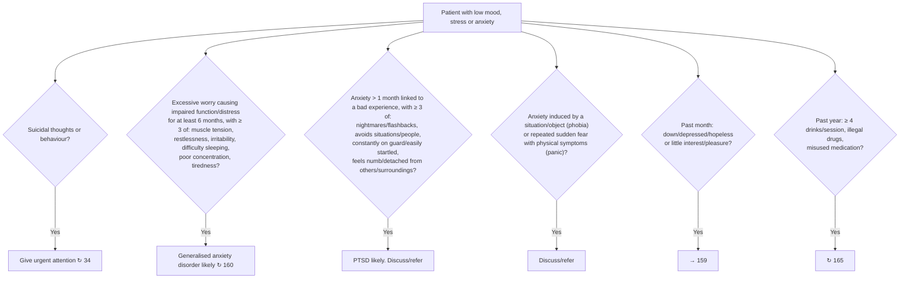

# Page 98 – Low mood, stress or anxiety: flowchart

Source: APC 2026 e-book page 98 (red box plus the "Assess" table). The page is a table, not a drawn
flowchart; its "If … likely" rows are multi-step conditions, so they are drawn here.

## Decision nodes → rules

| Node | Modelled as | Rule |
|---|---|---|
| Trigger | Depressed mood, Stress or Anxiety (finding) | `Check for urgent low mood, stress or anxiety conditions`, `Check for generalised anxiety disorder and PTSD features` |
| Red box | Complaint **and** (suicidal thoughts or suicidal behaviour) | `Urgent: low mood, stress or anxiety with suicidal thoughts or behaviour` |
| GAD | Excessive worry with onset ≥ 6 months ago **and** distress **and** ≥ 3 of the six symptoms | `Diagnose probable generalised anxiety disorder (low mood, stress or anxiety page)` |
| PTSD | Anxiety onset ≥ 1 month ago **and** victim of psychological trauma **and** ≥ 3 of the four groups | `Diagnose probable post-traumatic stress disorder (low mood, stress or anxiety page)` |
| Phobia / panic | Not modelled: the page says "discuss/refer", not "likely" or "consider" | none |
| Depression, substance use, abuse, stressors, women's health, medication | Routing to other pages or management | none |

## Notes

- "≥ 3 of" is written with `any2` nested in `or`/`and` (the language has only `any2`): the first
  present item plus at least two of the items after it. This is exactly equivalent to "at least 3".
