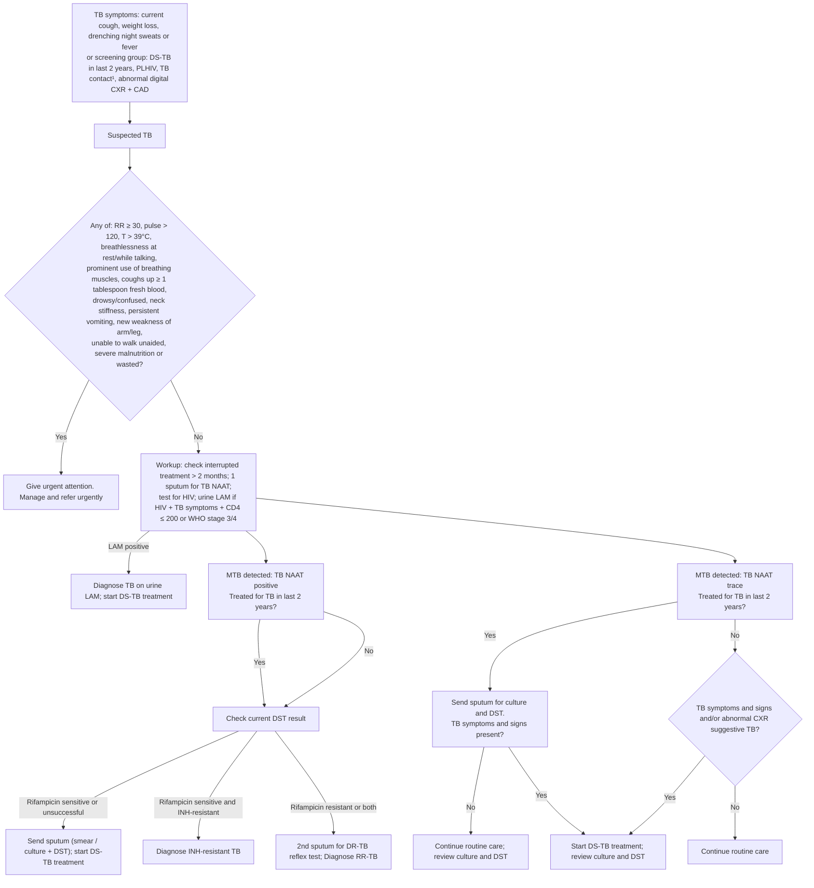

# Page 102 – Tuberculosis (TB): Diagnosis: flowchart

Source: APC 2026 e-book, page 102 (`inputs/2026/p102.png`).

¹ TB contact: shared an enclosed space for ≥ 1 night or frequent/extended daytime periods with an
index patient with pulmonary TB, in the 3 months before the index patient started treatment.

(The page's left "Yes" line from "treated for TB in last 2 years" runs down past the DST column;
the image does not show a separate destination box, so it is drawn as joining "Check current DST
result". Not modelled either way.)

## Decision nodes → rules

| Node | Modelled as | Rule |
|---|---|---|
| TB symptoms / TB contact / abnormal screening CXR → suspected TB | `or` of Cough, Weight decreased, Night sweats, active Fever, exposure to Mycobacterium tuberculosis complex, Plain X-ray of chest for tuberculosis screening abnormal | `Diagnose possible TB from TB symptoms, TB contact or abnormal screening CXR` |
| DS-TB in last 2 years, PLHIV screening schedule | Not modelled (timing schedule; see remaining questions) | — |
| Red box | `check_for` of the non-vital red-box items, triggered by possible TB | `Check for urgent suspected TB conditions` |
| Red box = Yes | `(and possible TB (or …red box…))` → Urgent | `Urgent: suspected TB with danger signs` |
| Workup, LAM, NAAT, DST branches, INH-resistant TB, RR-TB | Not modelled: lab results (NAAT, LAM, CD4, DST, culture) have no representation; the remainder is management | — |
