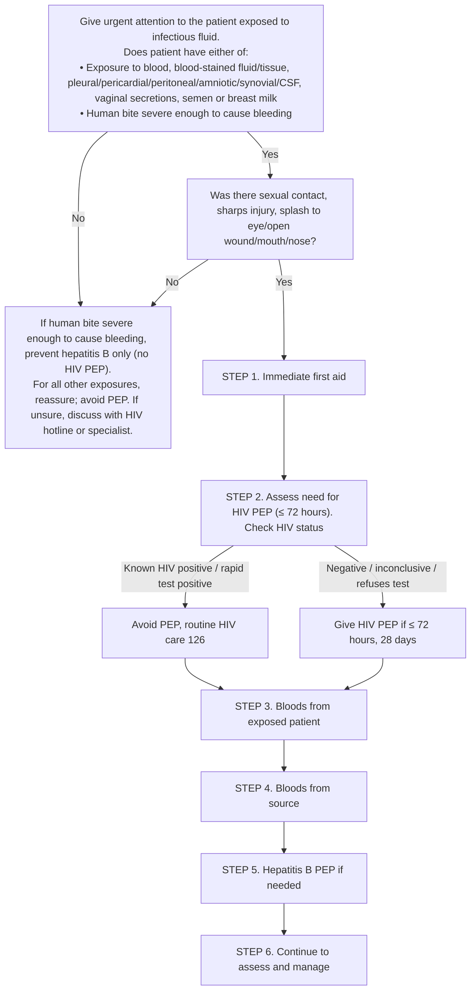

# Page 122 – HIV: post-exposure prophylaxis (PEP): flowchart

Source: `inputs/2026/p122.png` (red box). Only the triage entry is modelled; every step after it is management.

## Decision nodes → rules

| Node | Modelled as | Rule |
|---|---|---|
| Presenting complaint "exposed to infectious fluid" | Exposure to Body fluid, or Human bite - wound | `Check for HIV PEP: exposure to infectious fluid or human bite` (trigger) |
| H = Yes (either of) | `or` of exposure to each listed fluid, or (human bite **and** bleeding) | `Urgent: HIV PEP, exposure to infectious fluid or bleeding human bite` |
| H = No | Not modelled (reassurance, management) | — |
| R (sexual/sharps/splash) | Not modelled: routes only between management branches | — |
| STEP 1–6, HIV status branches | Not modelled: management (no `manage` tasks this pass) | — |
