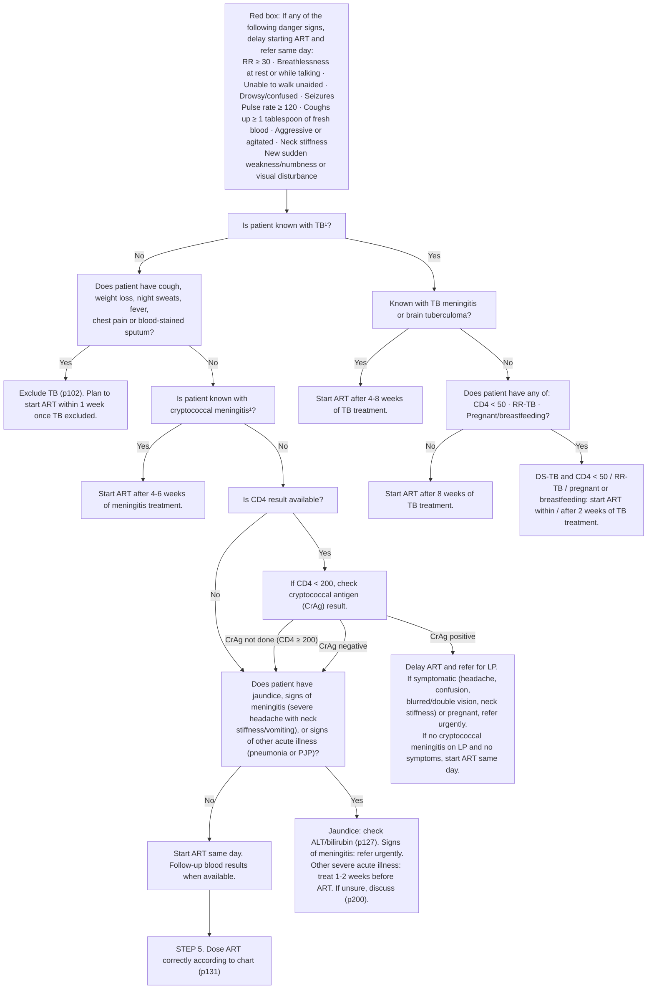

# Page 130 – HIV: Routine care (cont. 5): flowchart

Source: `inputs/2026/p130.png` (STEP 4. Check if there is a reason to delay ART). APC 2026.

¹ If patient has TB and cryptococcal meningitis, discuss with experienced ART clinician or HIV hotline about when to start ART.

## Decision nodes → rules

| Node | Modelled as | Rule |
|---|---|---|
| Red box (danger signs) | Known HIV infection **and** any of RR ≥ 30, pulse ≥ 120, dyspnoea at rest / unable to complete a sentence, unable to walk / dependent for walking, drowsy, acute confusion / clouded consciousness, seizure, haemoptysis, aggressive behaviour, feeling agitated, stiff neck, sudden-onset muscle weakness / numbness / visual disturbance | `Check for HIV: danger signs before starting ART`; `Urgent: HIV danger signs before starting ART` |
| Q1 = No → Q2 = Yes → "Exclude TB" | Known HIV **and** not known with TB **and** any of cough, weight decreased, night sweats, fever, chest pain, bloodstained sputum → `possible` Tuberculosis | `Check for HIV: TB symptoms and signs of meningitis before starting ART`; `Diagnose possible TB in HIV patient before starting ART` |
| Q6: signs of meningitis → "refer urgently" | Known HIV **and** severe headache **and** (stiff neck or vomiting) → Urgent | `Urgent: HIV with signs of meningitis before starting ART` |
| Q1 = Yes, Q3, Q8 (ART timing in known TB) | ART timing only (management) | not encoded |
| Q4 (known cryptococcal meningitis) | ART timing only (management) | not encoded |
| Q5, Q7 (CD4, CrAg) | Lab results have no observable/unit in the language | not encoded (Could not model) |
| CrAg positive and symptomatic → refer urgently | Depends on CrAg result (lab) | not encoded (Could not model) |
| Q6: jaundice, pneumonia/PJP | Lead only to management (ALT/bilirubin, treat illness, delay ART) | not encoded |

## Notes

- The red box and the meningitis rule are not gated on the patient not yet being on ART: the
  language has no "about to start ART" state. See remaining-questions.
- The meningitis priority is not gated on the earlier flowchart branches (no known TB, no TB
  symptoms, CrAg not positive); see remaining-questions.
