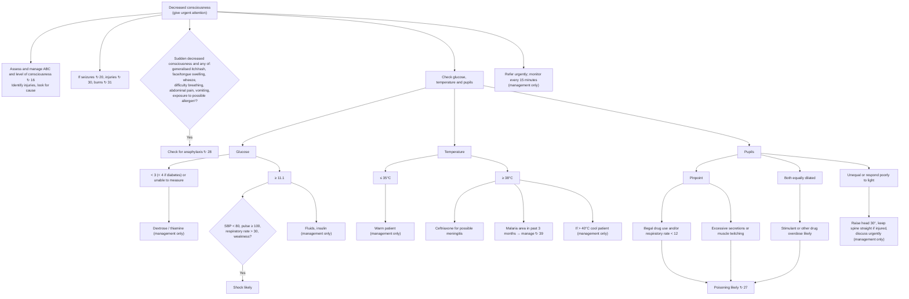

# Page 18 – Decreased consciousness: flowchart

Source: `inputs/2026/p18.png` (APC 2026). The whole page is one red box: "Give urgent attention to
the patient with decreased consciousness". It holds a list of first steps and then a three-way
decision tree (glucose, temperature, pupils).

¹ Common allergens include medication, food or insect bite/sting within the past few hours.

## Decision nodes → rules

| Node | Modelled as | Rule |
|---|---|---|
| Decreased consciousness (box header) | Trigger: `or` of Decreased level of consciousness and the three recorded AVPU levels below Alert (reacts to voice, reacts to pain, unresponsive) | `Check for causes of decreased consciousness`; `Urgent: decreased consciousness` |
| Sudden decreased consciousness + any anaphylaxis feature → check for anaphylaxis ↻ 28 | `possible` Anaphylaxis: sudden-onset decreased consciousness **and** any of generalised itch, generalised rash, face swelling, tongue swelling, wheeze, difficulty breathing, abdominal pain, vomiting, exposure to drug/food, insect bite/sting | `Diagnose possible anaphylaxis with sudden decreased consciousness` (feeds page 28's anaphylaxis check) |
| Glucose < 3 (< 4 if diabetes) or unable to measure | Not modelled: the branch names no diagnosis, only dextrose/thiamine management | none |
| Glucose ≥ 11.1 → SBP < 80, pulse ≥ 100, RR > 30, weakness → shock likely | `probable` Shock: trigger **and** glucose ≥ 11.1 **and** any of SBP < 80, pulse ≥ 100, RR > 30, weakness (Asthenia) | `Diagnose probable shock with decreased consciousness and glucose ≥ 11.1` |
| Temperature ≤ 35°C | Not modelled: management only (warming) | none |
| Temperature ≥ 38°C → "for possible meningitis" | `possible` Meningitis: trigger **and** temperature ≥ 38 | `Diagnose possible meningitis with decreased consciousness and temperature ≥ 38` |
| Temperature ≥ 38°C, malaria area → manage ↻ 39 | Not modelled: cross-reference to page 39 | none |
| Pinpoint + (illegal drug use and/or RR < 12) → poisoning likely | `probable` Poisoning, first branch | `Diagnose probable poisoning with decreased consciousness` |
| Pinpoint + (excessive secretions or muscle twitching) → poisoning likely | `probable` Poisoning, same branch (`or` of the two boxes) | `Diagnose probable poisoning with decreased consciousness` |
| Both equally dilated → stimulant or other drug overdose likely | `probable` Overdose: trigger **and** dilated pupils of both eyes | `Diagnose probable drug overdose with decreased consciousness and dilated pupils` |
| Stimulant/drug overdose likely → poisoning likely | `probable` Poisoning, second branch: trigger **and** dilated pupils of both eyes (evidence repeated, not `active_condition Overdose`, so it stays checked for in this file) | `Diagnose probable poisoning with decreased consciousness` |
| Unequal or respond poorly to light | Not modelled: the page attaches only management (head up, discuss) and names no diagnosis | none |

## Notes

- Glucose and temperature are routine vitals, so no `measure` task is written for them. Pupils are
  findings and go in the `check_for`.
- The page's "Unequal or respond poorly to light", "≤ 35°C" and "< 3 … or unable to measure"
  branches lead only to management, so nothing in the language consumes them; per Will's rule
  ("If the page really does not use a finding for anything, remove it from the check_for") they are
  not checked for.
