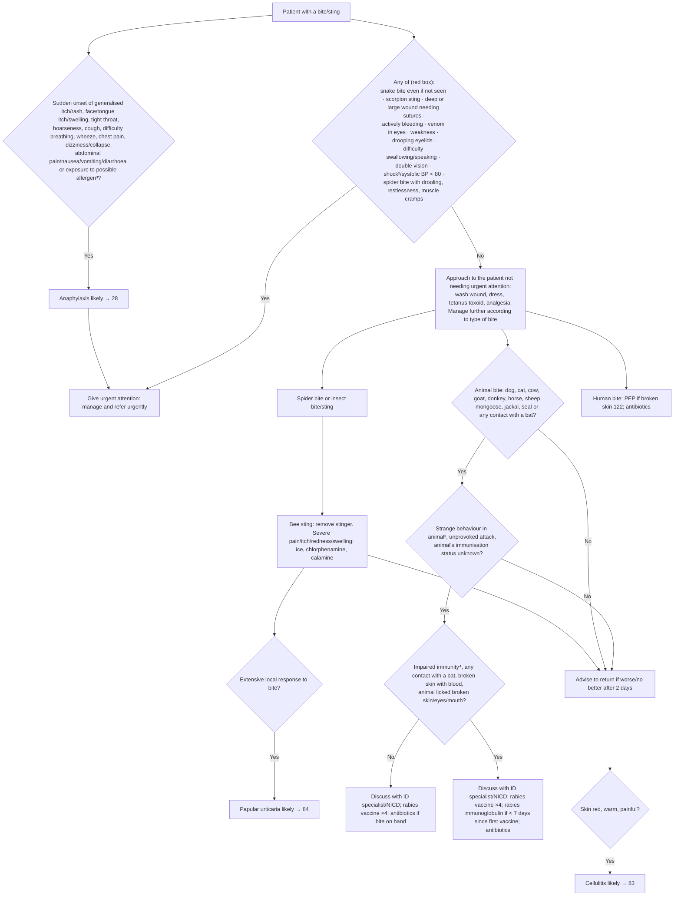

# Page 29 – Bites and stings: flowchart

Source: `inputs/2026/p29.png` (APC 2026 e-book, page 29): red box, then the approach to the patient
not needing urgent attention, which branches by type of bite.

Footnotes: ¹ obtain description of spider/snake/scorpion. ² If SBP < 80, pulse ≥ 100, respiratory
rate > 30, confusion/restlessness, weakness, shock likely. ³ (allergen) medications, new food or
insect bite/sting within the last few hours; ³ (animal) sick animal or domestic animal with unusual
aggression or wild animal that appears tame. ⁴ Symptomatic HIV, chemotherapy/radiotherapy, dialysis
or long-term corticosteroids.

## Decision nodes → rules

| Node | Modelled as | Rule |
|---|---|---|
| Patient with a bite/sting | `(or Bite - wound, Venomous sting)`. `Insect bite - wound` (common symptom), `Snake bite - wound`, `Spider bite wound` and `Poisoning due to bite of Scorpiones` all descend from `Bite - wound`; `Insect sting` descends from `Venomous sting` | Trigger of `Check for urgent bite/sting conditions` |
| Red box items | Each item a `check_for` finding; deep or large wound as `Deep bite wound` or `Bite - wound` + `Large`; venom in eyes as `Toxic effect of venom` at `Structure of eye proper`; spider bite as `(and Spider bite wound (or drooling, restlessness, cramp))`; shock as `(or Shock, systolic BP < 80)` | `Urgent: bite/sting with danger signs` |
| Anaphylaxis likely | Bite/sting **and** any sudden-onset item of the list | `Diagnose probable anaphylaxis after bite/sting`; consumed by `Urgent: bite/sting with danger signs` via `(active_condition Anaphylaxis)` |
| Papular urticaria likely | Spider/insect bite or insect sting **and** extensive insect bite reaction | `Diagnose probable papular urticaria after bite/sting` |
| Cellulitis likely | Bite/sting **and** erythema **and** warm skin **and** pain of skin | `Diagnose probable cellulitis after bite/sting` |
| Animal-bite rabies questions (Q2, Q3) and human bite | Management routing only (PEP, rabies vaccine/immunoglobulin, antibiotics); no "likely"/"consider" diagnosis | Not modelled (management) |

## Notes

- "Advise to return if worse/no better after 2 days" is a follow-up instruction, not modelled; the
  cellulitis rule fires whenever its findings are recorded, on this or a later visit.
- Footnote 2 ("shock likely") is not modelled as its own diagnosis rule; the red box item is
  encoded as written, `Shock` or systolic BP < 80 (see remaining questions).
