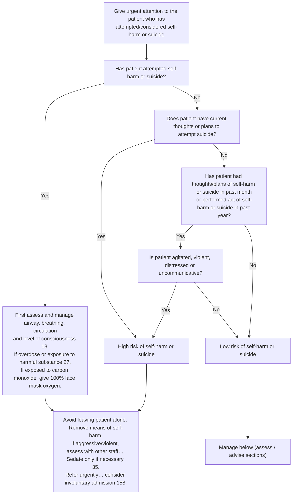

# Page 34 – Self-harm or suicide: flowchart

Source: `inputs/2026/p34.png` (red box; the whole algorithm sits inside it).

Note: the Yes branch of Q1 joins the same management box as "High risk" but does not pass through
the "High risk" box. It is Urgent through the header rule and is not diagnosed as high risk
(reconciler decision; see remaining questions).

## Decision nodes → rules

| Node | Modelled as | Rule |
|---|---|---|
| Header: attempted/considered self-harm or suicide | Trigger: `Suicide attempt`, `Intentionally harming self`, `Suicidal thoughts`, `Thoughts of self harm` (covers `Suicidal thoughts`, `Planning suicide`, `Thoughts of deliberate self harm` and their descendants) | `Check for self-harm or suicide risk`; `Urgent: attempted/considered self-harm or suicide` |
| Q1 = Yes | `Suicide attempt` or `Intentionally harming self` recorded in the encounter | `Urgent: attempted/considered self-harm or suicide` (no risk diagnosis) |
| Q2 = Yes | `Suicidal thoughts` or `Planning suicide`, each with qualifier `Current` | `Diagnose probable high risk of self-harm or suicide`, first branch |
| Q3 = Yes → Q4 = Yes | (onset of `Thoughts of self harm`, `Suicidal thoughts` or `Planning suicide` within 1 month, **or** onset of `History of attempted suicide` / `History of deliberate self harm` within 1 year) **and** any of `Feeling agitated`, `Aggressive behavior`, `Distress`, `Does not communicate` | same rule, second branch |
| Q4 = No → Low risk | No attempt, no current suicidal thoughts/plans, and none of the four Q4 findings (explicit `no` records) | `Diagnose probable low risk of self-harm or suicide` |
| Q3 = No → Low risk | Not modelled: "no thoughts in past month" cannot be expressed as a time-limited negative | see remaining-questions, Could not model |
| ABC / overdose / CO / management box | Management, not encoded | — |
