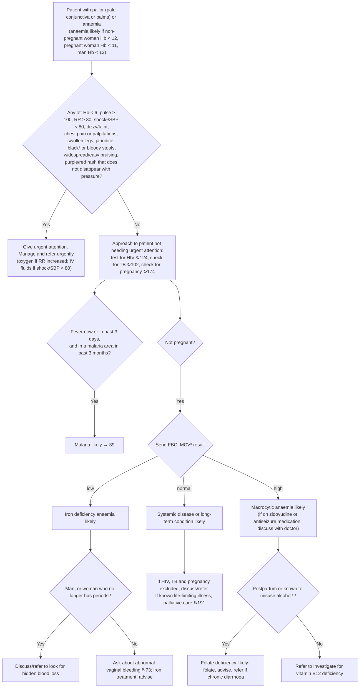

# Page 44 – Pallor and anaemia: flowchart

Source: `inputs/2026/p44.png` (APC 2026, page 44), red box 1 and the "Approach to the patient
with pallor/anaemia not needing urgent attention" algorithm below it.

¹ If SBP < 80, pulse ≥ 100, respiratory rate > 30, confusion/restlessness, weakness, shock likely.
² Black stools may be caused by iron tablets; only refer if black stools started before iron treatment.
³ MCV low, normal or high compared to the reference range on the FBC result sheet.
⁴ > 14 drinks/week or ≥ 4 drinks/session.

## Decision nodes → rules

| Node | Modelled as | Rule |
|---|---|---|
| START (presenting complaint) | `(or Pale complexion, Pale conjunctiva, Pale discoloration of entire skin of body, Anemia)` as `clinical_finding`s | trigger of `Check for urgent pallor/anaemia conditions` |
| RB = Yes | `(and <pallor/anaemia> (or …red box items…))`; Hb < 6 not representable | `Urgent: pallor/anaemia with danger signs` |
| RB items to ask | every red-box finding that is not a routine vital | `Check for urgent pallor/anaemia conditions` |
| MAL (question) | pallor/anaemia **and** `(active_condition Fever)` → ask about malaria area | `Check for malaria area exposure in pallor/anaemia with fever` |
| MAL = Yes | pallor/anaemia **and** Fever **and** endemic-area finding for Malaria | `Diagnose probable malaria in pallor/anaemia` |
| PREG, FBC/MCV, IDA, SYS, MAC, IDAQ, MACQ, FOL, B12 | **not modelled**: every branch below the FBC hangs on the MCV result, which the language cannot express (no lab observable or unit) | none (see remaining-questions, Could not model) |
| URG, APP, HID, IRON, SYSM, B12 actions | management / referral / cross-references | none (management_step, cross_reference_only) |

## Notes

- "Fever now or in past 3 days" is modelled as `(active_condition Fever)` only; a fever that has
  resolved within the last 3 days is not captured.
- "In a malaria area in past 3 months": the 3-month window is not modelled; the endemic-area
  finding ("recent area visited") is taken as recent.
- "Not needing urgent attention" is not encoded as a negation: the malaria rule fires whether or
  not the urgent rule also fires.
