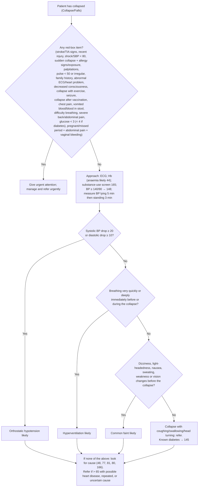

# Page 45 – Collapse/Falls: flowchart

Source: `inputs/2026/p45.png` (APC 2026, page 45). The red box is a flat "any of" list; the lower half
of the page ("Approach to the patient who has collapsed not needing urgent attention") is a
Yes/No algorithm.

## Decision nodes → rules

| Node | Modelled as | Rule |
|---|---|---|
| Patient has collapsed | `(or Collapse Falls)` as trigger (Falls from the page title; unsettled) | `Check for urgent collapse/falls conditions`, `Check for causes of collapse/falls`, `Measure lying and standing blood pressure after collapse/falls` |
| Red box (any of) | `(and (or Collapse Falls) (or …each red-box item…))` | `Urgent: collapse/falls with danger signs` |
| "consider stroke or TIA" | Collapse/falls **and** any sudden-onset face, arm or leg weakness or numbness, difficulty talking or visual disturbance | `Diagnose possible stroke after collapse/falls`, `Diagnose possible TIA after collapse/falls` |
| "Sudden collapse and any of … check for anaphylaxis" | Sudden-onset collapse **and** any of the listed allergy signs or exposures | `Diagnose possible anaphylaxis after sudden collapse` |
| Q1 = Yes | Collapse/falls **and** level of reduction in systolic BP on standing ≥ 20 mmHg (diastolic drop: no observable, not modelled); lying/standing systolic and diastolic BP are measured | `Diagnose probable orthostatic hypotension after collapse/falls` |
| Q1 = No → Q2 = Yes | Collapse/falls **and** systolic drop < 20 **and** (tachypnoea or excessively deep breathing) | `Diagnose probable hyperventilation after collapse/falls` |
| Q2 = No → Q3 = Yes | Collapse/falls **and** systolic drop < 20 **and** recorded No to tachypnoea **and** to excessively deep breathing **and** any prodromal symptom | `Diagnose probable common faint after collapse/falls` |
| Q3 = No; final box | Referral / cross-references only | not encoded (management / cross-reference) |
| Hb < 12 / < 13 → anaemia likely | Haemoglobin has no unit/observable in the language | not encoded (see remaining questions) |

## Notes

- "Not needing urgent attention" (entry to the algorithm) cannot be expressed as a negation of the
  priority evaluation; the flowchart rules fire whenever their evidence is present.
- Timing words ("immediately before or during", "before the collapse") are not modelled; findings
  recorded in the same encounter are taken as related to this collapse.

- Final build reconciled from two independent builds; see `reconcile.json`.
