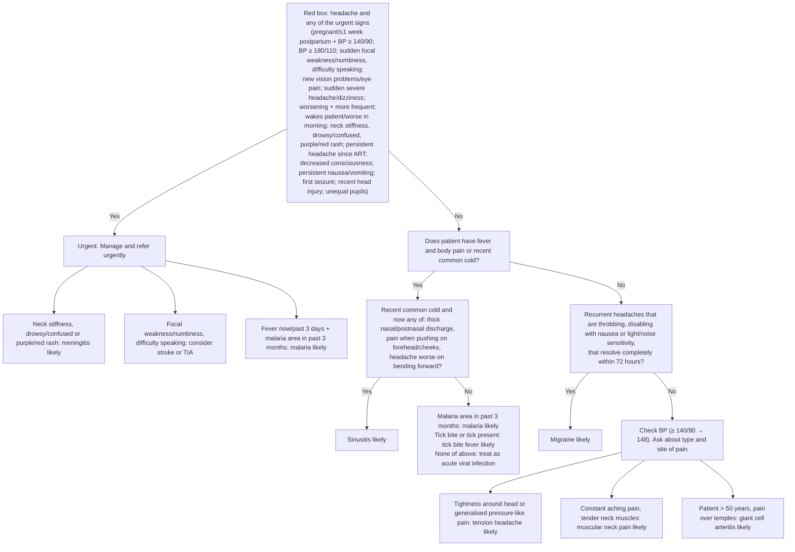

# Page 47 – Headache: flowchart

Source: `inputs/2026/p47.png` (red box and the "Approach to the patient with headache not needing urgent attention" flowchart).

## Decision nodes → rules

| Node | Modelled as | Rule |
|---|---|---|
| Red box | Headache **and** any of the red-box items | `Check for urgent headache conditions`, `Urgent: headache with red-box danger signs` |
| Meningitis likely | Headache and any of stiff neck, drowsy, clouded consciousness, acute confusion, purpuric rash | `Diagnose probable meningitis in headache` → `(active_condition Meningitis)` in the urgent rule |
| Consider stroke or TIA | Headache and any sudden-onset face/arm/leg weakness or numbness, or difficulty talking | `Diagnose possible stroke in headache`, `Diagnose possible TIA in headache` |
| Malaria likely (red box and Q2 = No) | Not encoded: no concept for "been in a malaria area" | — (see remaining questions) |
| Q1 → Q2 = Yes | Headache, recent common cold, and any of thick nasal discharge, thick posterior rhinorrhea, forehead/cheek tenderness ("worse on bending forward" has no concept) | `Diagnose probable sinusitis in headache` |
| Q1 = Yes → Q2 = No → tick | Headache, (fever and generalized aches) or recent common cold, and tick bite | `Diagnose probable tick bite fever in headache` |
| Q1 = Yes → Q2 = No → none of above | Headache, (fever and generalized aches) or recent common cold, recorded absence of the sinusitis branch (no recent cold, or none of its features), and no tick bite (the malaria-area exclusion is not representable) | `Diagnose possible acute viral infection in headache` |
| Q1 = No → Q3 = Yes | Recurrent throbbing headache and any of nausea, photophobia, phonophobia | `Diagnose probable migraine in headache` |
| Q3 = No → tension | Headache and (tightness sensation of head or generalized headache) | `Diagnose probable tension headache in headache` |
| Q3 = No → muscular neck | Headache, continuous aching pain and tender neck muscles | `Diagnose probable muscular neck pain in headache` |
| Q3 = No → GCA | Temporal headache (age > 50 not representable) | `Diagnose probable giant cell arteritis in headache` |
| All flowchart questions | Findings asked once | `Check for causes of headache not needing urgent attention` |

## Notes

- Except for acute viral infection, the "No" branches of Q1, Q2 and Q3 are not required as negative evidence (`no …`) in the later rules:
  each "likely" rule fires on its own positive findings. This makes them fire somewhat more often
  than a strict walk down the chart.
- "Check BP. If ≥ 140/90 → 148" is a cross-reference; BP is a routine vital.
- "If none of above, treat as acute viral infection" is encoded as a `possible` diagnosis (reconciler, from builder B); it is the only rule that needs the earlier answers as recorded negatives. The analgesia-overuse note is management.
