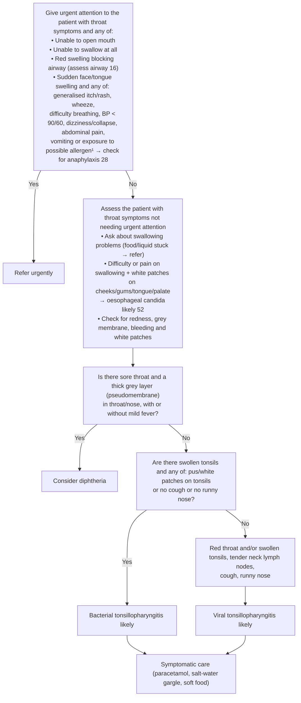

# Page 53 – Throat symptoms: flowchart

Source: APC 2026 e-book page 53 (`inputs/2026/p53.png`): red box, the "Assess" box and the
Yes/No flowchart below it.

¹ Common allergens include medication, food or insect bite/sting within the past few hours.

## Decision nodes → rules

| Node | Modelled as | Rule |
|---|---|---|
| Throat symptoms (trigger) | `(or Sore throat, Difficulty swallowing, Swallowing painful)` for the red box; `Sore throat` for the Assess box (which checks for difficulty / pain on swallowing) | due_to of `Check for urgent throat symptom conditions`; due_to of `Assess throat symptoms not needing urgent attention` |
| Red box | `(and throat symptoms (or unable to open mouth, unable to swallow, (and pharyngeal swelling, upper respiratory tract obstruction), (and sudden face/tongue swelling (or …anaphylaxis features…))))` | `Urgent: throat symptoms with danger signs` |
| Red box, anaphylaxis bullet ("check for anaphylaxis 28") | `possible` anaphylaxis: throat symptoms **and** sudden face/tongue swelling **and** any of the listed features; this hands over to page 28's check | `Diagnose possible anaphylaxis from throat symptoms with sudden face/tongue swelling` |
| Assess, bullet 2 | `(and (or Difficulty swallowing, Swallowing painful) White patches on oral mucosa)` → probable Candidiasis of esophagus | `Diagnose probable oesophageal candida from painful or difficult swallowing` |
| Q1 = Yes | `(and Sore throat (or pseudomembrane in pharynx, pseudomembrane in nose))`; mild fever is "with or without" so not required | `Diagnose possible diphtheria from throat/nose pseudomembrane` |
| Q1 = No → Q2 = Yes | `(and Sore throat (no pseudomembrane pharynx) (no pseudomembrane nose) Swelling of tonsil (or Exudate on tonsils, (no Cough), (no Nasal discharge)))` | `Diagnose probable bacterial tonsillopharyngitis` |
| Q1 = No → Q2 = No | `(and Sore throat (or Redness of throat, Swelling of tonsil) (no pseudomembranes) (or (no Swelling of tonsil) (and (no Exudate on tonsils) Cough Nasal discharge)))`. The descriptive box is used only for its first line as the positive anchor | `Diagnose probable viral tonsillopharyngitis` |
| Consider diphtheria management, antibiotics, symptomatic care | Management, not modelled | – |

## Notes

- Q2 = No is the logical negation of Q2: no swollen tonsils, **or** swollen tonsils with no
  pus/white patches **and** cough **and** runny nose.
- Q1 = No is encoded as "no pseudomembrane in throat or nose" rather than the full negation
  (which would also include "no sore throat"), because every patient on this flow already has a
  throat symptom.
- BP < 90/60 is read as systolic < 90 **or** diastolic < 60.
- "Within the past few hours" (footnote 1) is not modelled as a time comparison: the page gives
  no number.
