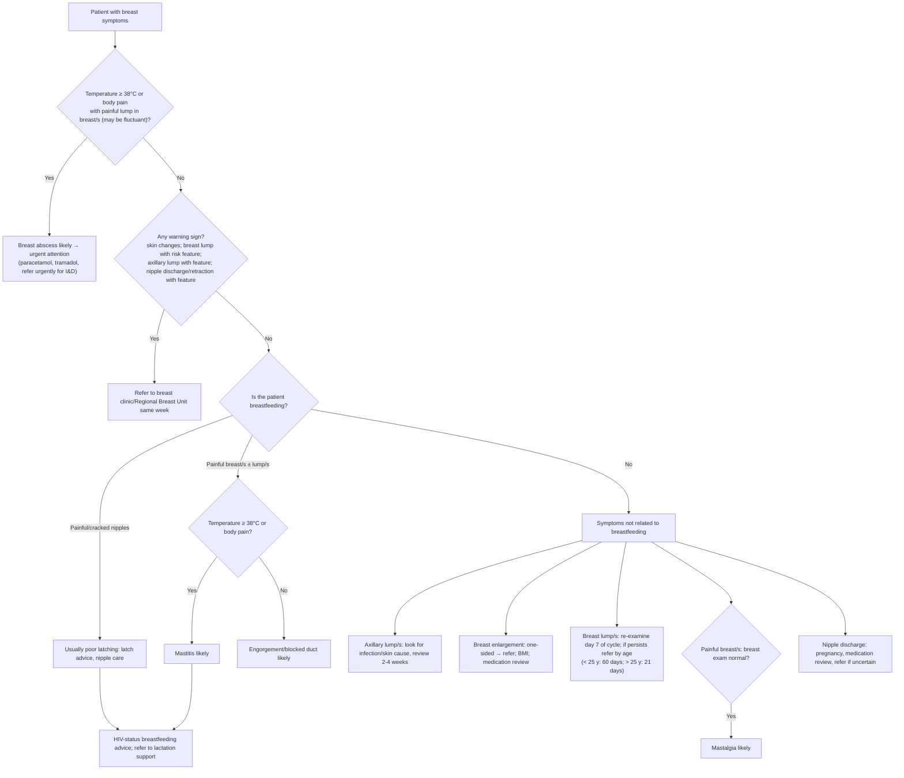

# Page 55 – Breast symptoms: flowchart

Source: APC 2026 e-book page 55 (`inputs/2026/p55.png`), red box plus the "Approach to the patient
with breast symptoms not needing urgent attention" algorithm.

## Decision nodes → rules

| Node | Modelled as | Rule |
|---|---|---|
| Red box | Breast finding **and** (temperature ≥ 38 °C **or** generalized aches and pains) **and** breast lump **and** pain of breast | `Diagnose probable breast abscess` → `Urgent: breast symptoms with likely breast abscess` |
| What is asked | Breast finding (presenting complaint) triggers the check-for task | `Check for breast symptom conditions` |
| Warning signs → refer same week | Referral criteria, no diagnosis named | Not encoded (`management_step`) |
| Breastfeeding, painful breast/s ± lump/s, fever/body pain = Yes | Maternal breastfeeding **and** pain of breast **and** (temperature ≥ 38 °C **or** generalized aches and pains) | `Diagnose probable mastitis associated with lactation` |
| Breastfeeding, painful breast/s ± lump/s, fever/body pain = No | Maternal breastfeeding **and** pain of breast **and** temperature < 38 °C **and** (no generalized aches and pains) | `Diagnose probable breast engorgement` (Milk engorgement of breast) and `Diagnose probable blocked milk duct` |
| Painful/cracked nipples | "Usually due to poor latching": no "likely" diagnosis | Not encoded (`management_step`) |
| Not breastfeeding → painful breast/s, breast exam normal | (no maternal breastfeeding) **and** pain of breast **and** breast normal | `Diagnose probable mastalgia` |
| Axillary lump, breast enlargement, breast lump, nipple discharge | Management and referral only | Not encoded |

## Notes

- "Body pain" is encoded as `Generalized aches and pains` (finding).
- "Painful lump in breast/s" is encoded as the pair `Breast lump` + `Pain of breast`; no
  "painful" qualifier exists in SNOMED. "Which may be fluctuant" is descriptive (not required) and
  is not encoded.
- The "No" branch of "temperature ≥ 38°C or body pain?" is encoded as temperature < 38 °C and no
  generalized aches and pains.
