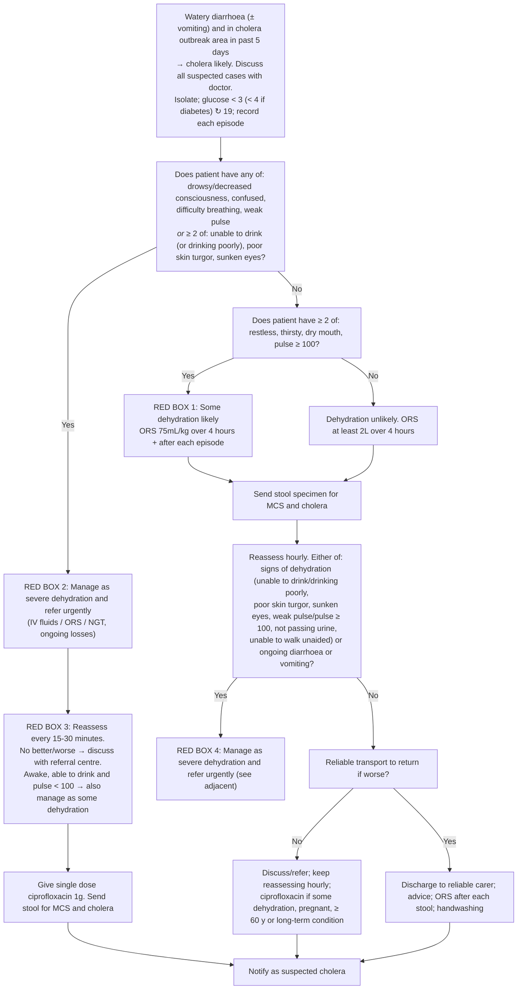

# Page 59 – Cholera: flowchart

Source: `inputs/2026/p59.png` (APC 2026 e-book, page 59; four red boxes).

## Decision nodes → rules

| Node | Modelled as | Rule |
|---|---|---|
| Diarrhoea presents (entry) | `Diarrhea` (common symptom) triggers the questions for cholera | `Check for cholera (cholera page)` |
| C: cholera likely | Watery diarrhoea (Diarrhea + `Watery` qualifier) **and** exposure to *Vibrio cholerae* with onset within the past 5 days (`<=`). "With or without vomiting" adds no condition | `Diagnose probable cholera` |
| Cholera → dehydration questions | `(active_condition Cholera)` triggers the dehydration check | `Check for level of dehydration in cholera` |
| Q1 = Yes | Cholera **and** (any of drowsy / decreased consciousness / confused / difficulty breathing / weak pulse **or** `any2` of unable to drink-or-drinking-poorly, poor skin turgor, sunken eyes) | `Urgent: cholera with severe dehydration` |
| Q1 = No → Q2 = Yes | Cholera **and** `(not Q1)` **and** `any2` of restless, thirsty, dry mouth, pulse ≥ 100 | `Diagnose probable some dehydration in cholera` → `Urgent: cholera with some dehydration` (red box 1) |
| Q2 = No: dehydration unlikely | Not modelled ("unlikely" has no form) | — |
| Reassess every 15–30 min (red box 3) | Not modelled: reassessment after IV treatment; management | — |
| Reassess hourly → red box 4 | Not modelled: a re-evaluation after ORS, which the language cannot tell apart from the first assessment (see remaining questions) | — |
| Transport / discharge / ciprofloxacin / notify | Management | — |

## Notes

- "Pulse ≥ 100" is `(>= (measurement "Pulse, function" bpm) 100)`.
- "Confused" is either `Acute confusion` (checked for) or `Clouded consciousness` (the AVPU "Confused" vital).
- "Unable to drink (or drinking poorly)" is one group: `Unable to drink` or `Difficulty drinking`, counted once inside the `any2`.
