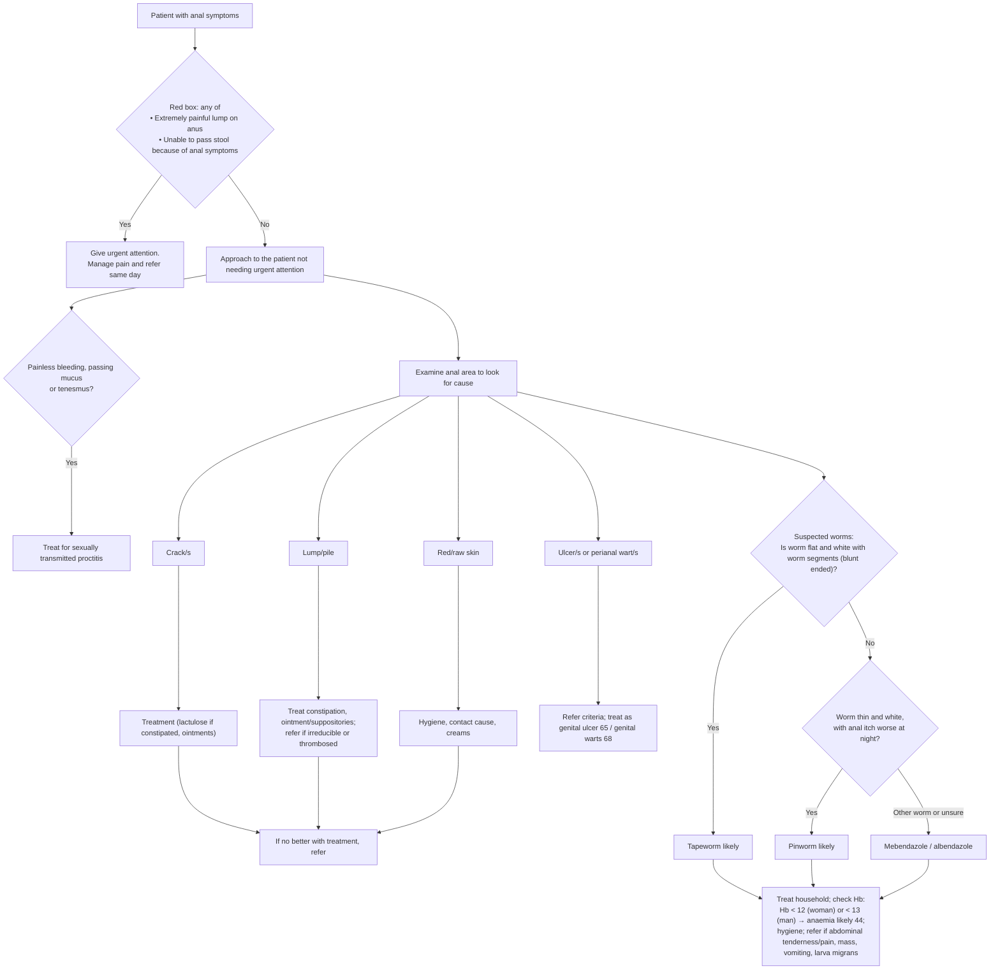

# Page 61 – Anal symptoms: flowchart

Source: `inputs/2026/p61.png` (APC 2026, page 61). The red box is a single "any of" list; the
lower half of the page is an examination algorithm with one Yes/No branch (suspected worms).

## Decision nodes → rules

| Node | Modelled as | Rule |
|---|---|---|
| Patient with anal symptoms | `(clinical_finding Anal finding)` as the task trigger (descendants such as Anal pain, Pruritus ani, Anal fissure match) | `Check for urgent anal symptom conditions` |
| Red box = Yes | Anal finding **and** (Perianal lump **and** severe Anal pain, **or** Does not defecate) | `Urgent: anal symptoms with extremely painful lump or unable to pass stool` |
| Painless bleeding / mucus / tenesmus → treat for STI proctitis | Anal finding **and** any of Painless rectal bleeding, Mucus in stool, Tenesmus of anus and/or rectum → `Infective proctitis` at `probable` | `Diagnose probable sexually transmitted proctitis from anal symptoms` |
| Suspected worms → No → thin white worm with anal itch worse at night → pinworm likely | Worms in stool **and** Pruritus ani qualified `Night time` → `Enterobiasis` at `probable`. "Thin and white" and "not flat/segmented" are not representable | `Diagnose probable pinworm from anal itch at night` |
| Suspected worms → Yes → tapeworm likely | **Not encoded**: the only discriminator (flat, white, segmented worm) has no SNOMED finding; see remaining questions | — |
| Hb < 12 / < 13 → anaemia likely | **Not encoded**: haemoglobin has no unit/observable in the language | — |
| Crack/s, Lump/pile, Red/raw skin, Ulcer/wart branches | Examination routing to management only; the page names no "likely" diagnosis on these branches | — (management) |
