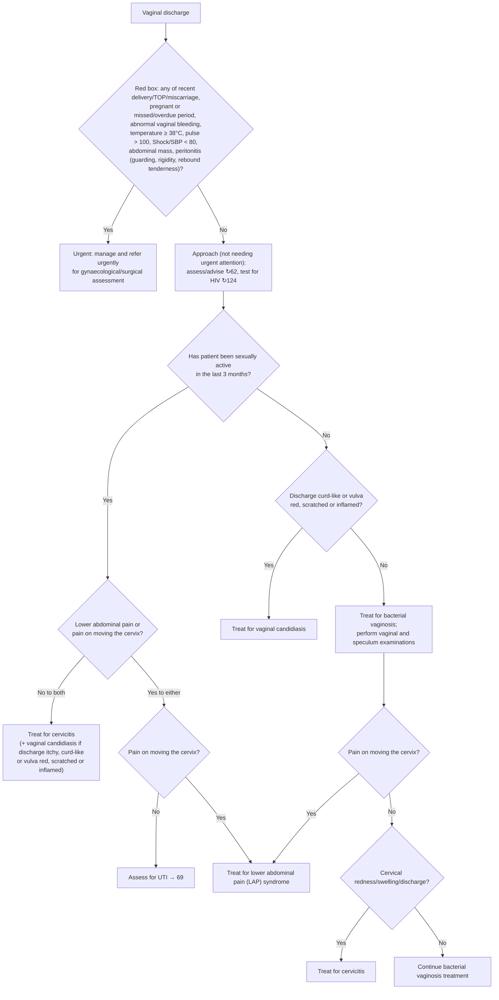

# Page 64 – Abnormal vaginal discharge: flowchart

Source: APC 2026 page 64 (`inputs/2026/p64.png`), red box and "Approach to a patient with an
abnormal vaginal discharge not needing urgent attention".

## Decision nodes → rules

| Node | Modelled as | Rule |
|---|---|---|
| Presenting complaint | `Vaginal discharge` (finding) | `Check for abnormal vaginal discharge findings` (task trigger) |
| Red box | `(and Vaginal discharge (or …8 red-box items…))`; Shock/SBP < 80 as `(or Shock (< SBP 80))`; peritonitis as the disorder or its three listed signs; overdue period as `Menstrual period late`; recent delivery/TOP/miscarriage with the `Recent` qualifier | `Urgent: vaginal discharge with danger signs` |
| SA = Yes → Y1 = No to both → Treat for cervicitis | Discharge, sexually active, `(no Lower abdominal pain)`, `(no Pain on movement of cervix)` | `Diagnose probable cervicitis (vaginal discharge)`, first branch |
| … → "If discharge itchy, curd-like or vulva red, scratched or inflamed: add vaginal candidiasis" | Same branch **and** any of `Pruritus of vagina`, vulval erythema, vulval scratch marks, vulval inflammation (curd-like: no SNOMED concept) | `Diagnose probable vaginal candidiasis (vaginal discharge)`, second branch |
| SA = Yes → Y1 = Yes → Y2 = No → Assess for UTI → 69 | Discharge, sexually active, lower abdominal pain, `(no Pain on movement of cervix)` | `Diagnose possible UTI (vaginal discharge, lower abdominal pain)` |
| Y2 = Yes / N2 = Yes → Treat for LAP syndrome | Discharge, pain on moving cervix, and either sexually active, or not sexually active with no vulval signs (the path that reaches N2) | `Diagnose probable LAP syndrome (vaginal discharge)` |
| SA = No → N1 = Yes → Treat for vaginal candidiasis | Discharge, `(no Sexually active)`, any of vulval erythema / scratch marks / inflammation (curd-like: no SNOMED concept) | `Diagnose probable vaginal candidiasis (vaginal discharge)`, first branch |
| SA = No → N1 = No → Treat for bacterial vaginosis | Discharge, `(no Sexually active)`, none of the vulval signs | `Diagnose probable bacterial vaginosis (vaginal discharge)` |
| N2 = No → N3 = Yes → Treat for cervicitis | BV path **and** `(no Pain on movement of cervix)` **and** any of cervical erythema / swelling / discharge | `Diagnose probable cervicitis (vaginal discharge)`, second branch |
| N3 = No → Continue BV treatment | Covered by the BV rule (BV is treated on the whole SA = No / N1 = No path) | `Diagnose probable bacterial vaginosis (vaginal discharge)` |

## Notes

- "In the last 3 months" is not modelled: a recorded `Sexually active` finding is taken as
  current (no SNOMED concept for exactly 3 months; see remaining questions).
- "Curd-like" discharge has no SNOMED concept, so both curd-like branches fire only on the vulval
  signs (and, in the sexually-active branch, itching).
- Diagnosis rules do not require the absence of the red-box items ("not needing urgent attention"),
  following the gold standard's style; the urgent priority is evaluated independently.
