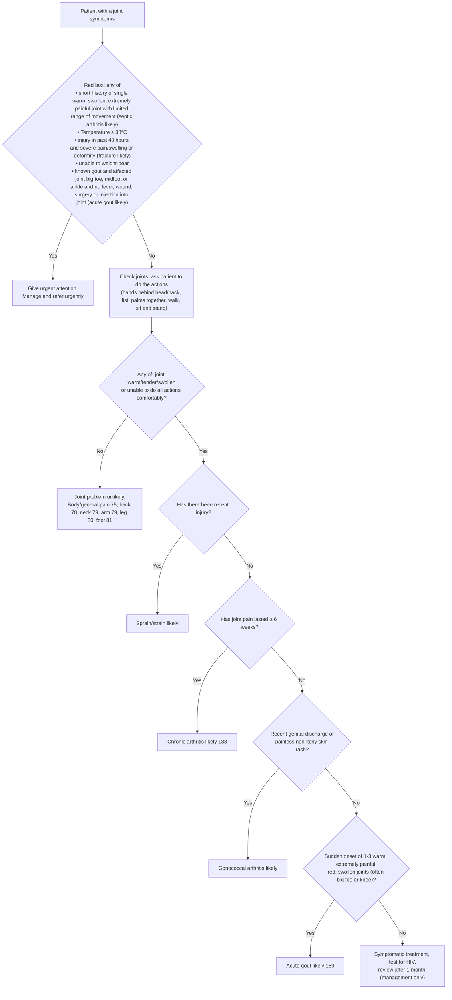

# Page 77 – Joint symptoms: flowchart

Source: `inputs/2026/p77.png` (APC 2026, page 77). The red box ("Give urgent attention to the
patient with a joint symptom/s and:") sits above a non-urgent algorithm ("Approach to the patient
with a joint symptom/s not needing urgent attention").

## Decision nodes → rules

| Node | Modelled as | Rule |
|---|---|---|
| Presenting complaint "joint symptom/s" | `Pain of joint` (finding) | trigger of `Check for urgent joint symptom conditions` |
| RB: septic arthritis likely | warm **and** swollen **and** severe joint pain **and** limitation of joint movement ("short history" and "single" joint not modelled) | `Diagnose probable septic arthritis (joint symptoms)` → `Urgent: joint symptoms with danger signs` |
| RB: Temperature ≥ 38°C | body temperature ≥ 38 °C | `Urgent: joint symptoms with danger signs` |
| RB: fracture likely | traumatic injury with onset ≤ 48 hours ago **and** any of severe joint pain, severe joint swelling, deformity | `Diagnose probable fracture (joint symptoms)` → `Urgent: joint symptoms with danger signs` |
| RB: unable to weight-bear | `Unable to weight-bear` | `Urgent: joint symptoms with danger signs` |
| RB: acute gout likely (known gout) | known gout **and** joint pain at big toe joint, midfoot or ankle joint **and** no fever **and** no wound (surgery/injection into joint not modelled) | inline in `Urgent: joint symptoms with danger signs`; also first branch of `Diagnose probable acute gout (joint symptoms)` |
| Q1 = Yes | any of joint warm, tenderness of joint, joint swelling, limitation of joint movement | shared gate in the sprain, chronic arthritis and gonococcal rules (the gout rule's own criteria already include warm and swollen) |
| Q1 = No → Joint problem unlikely | routing to other pages only | not encoded (flowchart_routing / cross_reference_only) |
| Q2 = Yes → Sprain/strain likely | Q1 gate **and** traumatic injury | `Diagnose probable sprain/strain (joint symptoms)` |
| Q2 = No → Q3 = Yes → Chronic arthritis likely | Q1 gate **and** `(no Traumatic injury)` **and** joint pain onset ≥ 6 weeks ago | `Diagnose probable chronic arthritis (joint symptoms)` |
| Q3 = No → Q4 = Yes → Gonococcal arthritis likely | Q1 gate **and** `(no Traumatic injury)` **and** joint pain onset ≤ 6 weeks ago **and** (vaginal or urethral discharge, or painless rash with no itching) | `Diagnose probable gonococcal arthritis (joint symptoms)` |
| Q4 = No → Q5 = Yes → Acute gout likely | `(no Traumatic injury)` **and** joint pain onset ≤ 6 weeks ago **and** joint warm **and** sudden-onset severe joint pain **and** erythema of joint **and** joint swelling **and** no vaginal discharge, no urethral discharge, no painless rash (Q4 = No) ("1-3 joints" not modelled) | second branch of `Diagnose probable acute gout (joint symptoms)` |
| Q5 = No | management only | not encoded (management_step) |

## Notes

- "< 6 weeks" (Q3 = No) is written `(<= (onset …) (time_ago 6 weeks))` because the database only
  accepts `>=` and `<=` in onset comparisons; the 6-week boundary itself falls in both branches.
- "Recent injury" (Q2) and "recent genital discharge" (Q4) are read as recorded in the current
  encounter, as the gold standard does for "in the few hours before".
- The flowchart's acute gout and the red box's acute gout share one diagnosis concept. Only the red
  box's known-gout criteria make the patient urgent, so the priority rule uses those criteria
  inline rather than `(active_condition Acute gout)`.
