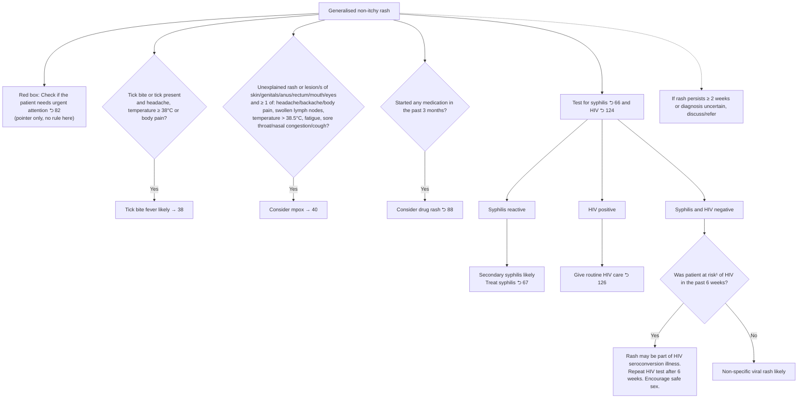

# Page 87 – Generalised non-itchy rash: flowchart

Source: `inputs/2026/p87.png` (APC 2026). The red box is a pointer only ("Check if the patient
needs urgent attention ⮌ 82"); the page's own logic is the bullet list and the test-result
flowchart below it.

¹ HIV can be transmitted via exposure to infectious body fluids, through sexual contact, occupational
or non-occupational exposure, sharing needles, contact with used condom and exposure to blood.

## Decision nodes → rules

| Node | Modelled as | Rule |
|---|---|---|
| Presenting complaint | `Generalized rash` (disorder) as the trigger | `Check for causes of generalised non-itchy rash` |
| Red box (pointer to 82) | Not modelled here; page 82 owns the urgent-attention logic | – |
| TICK = Yes | `(and Generalized rash (or Tick bite, Ixodidae infestation, Argasidae infestation) (or Headache, temperature ≥ 38, Generalized aches and pains))` | `Diagnose probable tick bite fever (generalised rash page)` |
| MPOX = Yes | `(and (or Skin lesion, lesion of genitalia/anus/rectum/mouth/eye) (or Headache, Backache, Generalized aches and pains, Lymphadenopathy, temperature > 38.5, Fatigue, Sore throat, Nasal congestion, Cough))` | `Diagnose possible mpox (generalised rash page)` |
| DRUG = Yes | Rash **and** exposure to `Drug or medicament` with onset within 3 months | `Diagnose possible drug rash (generalised rash page)` |
| Syphilis reactive | Rash **and** `Syphilis titer detected` | `Diagnose probable secondary syphilis (generalised rash page)` |
| HIV positive | Management only (routine HIV care) | – |
| Syphilis and HIV negative → RISK = Yes | Rash **and** `Syphilis titer not detected` **and** `Human immunodeficiency virus not detected` **and** HIV exposure with onset within 6 weeks | `Diagnose possible HIV seroconversion illness (generalised rash page)` |
| Syphilis and HIV negative → RISK = No | Same negatives **and** (HIV exposure recorded as No, **or** exposure onset at least 6 weeks ago) | `Diagnose probable non-specific viral rash (generalised rash page)` |
| Persists ≥ 2 weeks / uncertain | Referral step, not modelled | – |
